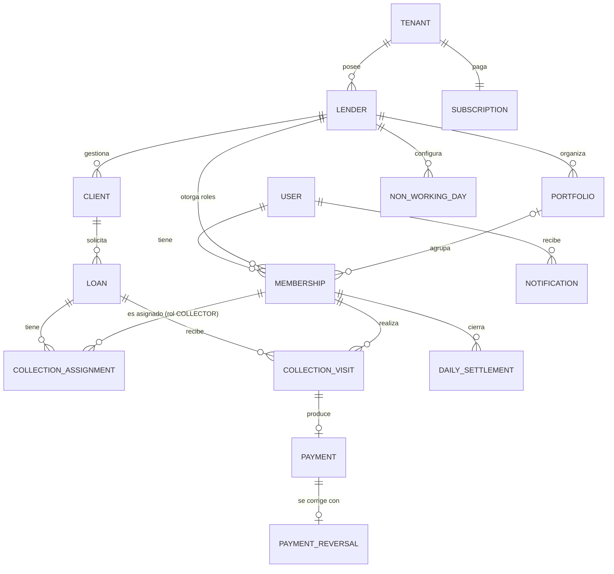

# Arquitectura — Sistema de Control de Cartera (Gota a Gota)

> Documento de producto: consolida las decisiones de dominio, arquitectura e infraestructura a nivel de negocio (entidades, multi-tenancy, suscripciones, roadmap). Esta es la copia canónica y versionada — actualízalo aquí cada vez que se tome una decisión nueva; es la fuente de verdad para cualquiera que se sume al proyecto (incluido tú mismo en 3 meses).
>
> Para la arquitectura de código de este repo (estructura de carpetas, convenciones, reglas de dependencia) ver [ARCHITECTURE.md](./ARCHITECTURE.md).

## 1. Resumen del proyecto

Sistema SaaS multi-tenant para que dueños de comercio (Owners) gestionen la operación de uno o varios prestamistas (Lenders) dedicados a crédito informal de cobro diario. El sistema **no calcula intereses ni procesa pagos reales** — es un libro de control (ledger) de acuerdos pactados manualmente entre el Lender y su cliente, con seguimiento de cobro en campo por parte de Collectors.

El valor diferencial del producto no es prestar dinero, es la **visibilidad**: mora en tiempo real, efectividad de cobro por cobrador, y estadísticas que hoy ninguna hoja de Excel puede dar de forma confiable.

## 2. Repositorios

| Repo | Contenido | Despliegue |
|---|---|---|
| `api` | NestJS, arquitectura hexagonal interna, Prisma | Fly.io (Docker) |
| `web` | Next.js + Tailwind, panel de Owner/Lender — **fase 2** (ver D-01) | Vercel |
| `mobile` | Expo (React Native), app única para Lender **y** Collector, navegación por rol | Distribución directa (sin Play Store) |
| `contracts` | Paquete npm privado `@fiaro-app/contracts` con schemas de Zod compartidos | GitHub Packages |

`contracts` no es una app, es una librería. Se versiona con semver (`1.2.0`) y `api`/`web` la instalan como dependencia normal. `mobile` puede consumirla también, pero no es obligatorio.

## 3. Stack tecnológico

| Capa | Tecnología | Justificación breve |
|---|---|---|
| Backend | NestJS + TypeScript | Arquitectura por capas, DI nativa, ecosistema maduro |
| ORM | **Prisma** | Migraciones declarativas, cliente tipado; se aísla del dominio con mapper (ver sección 4.3) |
| Base de datos relacional | PostgreSQL (Neon, free tier) | Fuente de verdad transaccional |
| Cache / colas | Redis (Upstash, free tier) + BullMQ | Cache de estado de crédito + jobs asíncronos de auditoría |
| Auditoría / logs de eventos | MongoDB Atlas M0 (free) | Datos no estructurados, nunca datos transaccionales del crédito |
| Frontend web | Next.js + Tailwind | Estándar actual, buen soporte de Vercel |
| App móvil | Expo (React Native, managed workflow) | Curva de entrada baja, OTA updates nativas |
| Autenticación | better-auth (librería self-hosted, tablas en nuestro Postgres vía Prisma), teléfono + contraseña | Sesiones, revocación y rate limit sin escribirlos; cero costo y cero lock-in (ver D-08 y D-48) |
| Almacenamiento de archivos | Cloudflare R2 (S3-compatible) con URLs firmadas | 10 GB gratis, sin costo de egress; logo ahora, KYC en fase 2 |
| CI/CD | GitHub Actions | Gratis, lint + test + build + deploy |
| Análisis estático | ESLint estricto + CodeQL | SonarCloud gratis solo en repos públicos — no aplica si el repo es privado |
| Logging | Pino (JSON estructurado) | Preparado para conectar a cualquier plataforma de observabilidad después |
| Errores | Sentry (free tier) | Visibilidad de errores en producción |

## 4. Arquitectura hexagonal (repo `api`)

### 4.1 Estructura por módulos

Un módulo por funcionalidad del dominio en `src/modules/<módulo>/` (`loans`, `clients`, `collections`...), cada uno con sus capas `domain`, `application` e `infrastructure`. El código transversal (auditoría, crypto, filtros, notificaciones, persistencia compartida, Swagger...) vive en `src/shared/`, con las mismas tres capas. El árbol completo, el propósito de cada carpeta y las convenciones de nombres están en [ARCHITECTURE.md §2](./ARCHITECTURE.md#2-estructura-de-carpetas).

### 4.2 Regla de dependencia (obligatoria)

Dentro de cada módulo, `domain` no importa de ninguna otra capa ni de librerías externas; `application` solo depende de `domain` (y de `@nestjs/common` para la inyección de dependencias); `infrastructure` puede depender de todo el módulo. Entre módulos, solo `application` usa el `application` de otro módulo; `shared` nunca depende de un módulo. Se fuerza con ESLint (`eslint-plugin-boundaries`), no con disciplina de equipo: el lint falla si una importación rompe la regla. Tabla completa en [ARCHITECTURE.md §3](./ARCHITECTURE.md#3-regla-de-dependencia-obligatoria-forzada-por-lint).

### 4.3 Prisma sin ensuciar el dominio

Prisma genera su propio cliente tipado, pero ese tipo **no es tu entidad de dominio**. Se traduce con un mapper explícito, siempre en `infrastructure`:

```typescript
// modules/loans/domain/entities/loan.entity.ts — sin decoradores, sin Prisma
export class Loan {
  private constructor(
    public readonly id: string,
    public readonly clientId: string,
    public readonly lenderId: string,
    public readonly principalAmount: number,
    public readonly totalPayable: number,
    public readonly status: LoanStatus,
  ) {}

  static reconstitute(props: LoanProps): Loan {
    return new Loan(props.id, props.clientId, props.lenderId, props.principalAmount, props.totalPayable, props.status);
  }
}
```

```typescript
// modules/loans/infrastructure/persistence/loan.mapper.ts
export class LoanMapper {
  static toDomain(record: PrismaLoan): Loan {
    return Loan.reconstitute({ ...record });
  }

  static toPersistence(loan: Loan): Prisma.LoanCreateInput {
    return { id: loan.id, clientId: loan.clientId, lenderId: loan.lenderId, /* ... */ };
  }
}
```

```typescript
// modules/loans/infrastructure/persistence/prisma-loan.repository.ts
@Injectable()
export class PrismaLoanRepository implements LoanRepository {
  constructor(private readonly prisma: PrismaService) {}

  async findById(id: string): Promise<Loan | null> {
    const record = await this.prisma.loan.findUnique({ where: { id } });
    return record ? LoanMapper.toDomain(record) : null;
  }
}
```

## 5. Modelo de dominio

> Diagrama conceptual (relaciones). La forma pública de cada entidad (campos, tipos y validaciones) está en el paquete `@fiaro-app/contracts`; el detalle de persistencia (columnas, índices, constraints) vive en `schema.prisma`. Este diagrama se regenera desde el esquema.



### Entidades clave

- **User**: identidad de login (una persona). Celular único global + contraseña; email opcional. Guarda también la cédula de la persona (obligatoria para cobradores) y `must_change_password`, porque son de la persona y de su credencial, no de su relación con un prestamista (D-34). **No tiene rol propio** — los roles viven en `Membership`. Tablas de sesión/cuenta las gestiona better-auth.
- **Membership**: `User` ↔ `Lender` con un **conjunto** de roles (`OWNER`, `LENDER`, `COLLECTOR`). Una misma cuenta puede tener los 3 a la vez (el operador que trabaja solo) — ver D-02. Campos propios: `portfolio_id` (obligatorio si tiene rol `COLLECTOR`), `status: ACTIVE | INACTIVE` y `deactivated_at`.
- **Tenant**: raíz de facturación. En el MVP el registro crea `Tenant` + `Lender` + `Membership` con los 3 roles en una sola transacción (1:1); el modelo ya soporta N Lenders por Tenant.
- **Lender**: la operación/negocio (`name`, `logo_url`, `non_working_weekdays`, `skip_national_holidays`). Aísla su cartera de otros Lenders, incluso del mismo Tenant.
- **Portfolio**: agrupación opcional de cobradores/clientes por zona. Cada Lender nace con una `General` por defecto.
- **NonWorkingDay** (+ días de la semana no hábiles en config del Lender): días en que no se cobra; excluidos del cálculo de fechas esperadas.
- **Client**: persona deudora, no es usuario. Aislado por `lender_id`; `national_id` **único por Lender**. Puede tener varios `Loan` activos a la vez (la UI alerta al crear uno nuevo).
- **Loan**: `principal_amount`, `installment_count`, `installment_value`, `total_payable`, `frequency` (`DAILY | WEEKLY | BIWEEKLY | MONTHLY`), `start_date`. `total_payable` es un **campo guardado** (la UI sugiere `cuotas × valor`, pero se respeta lo pactado). El calendario de cuotas **no se materializa**: fechas esperadas, mora y días de atraso se calculan desde `start_date + frequency − días no hábiles`. Saldo = `total_payable − Σ pagos netos`. Estados: `ACTIVE`, `PAID_OFF` (automático al llegar el saldo a cero) y `CANCELED` (anulación por error antes de recibir pagos) (D-35). Solo el Lender crea préstamos (el Collector no, en MVP).
- **CollectionAssignment**: quién cobra un préstamo y en qué ventana (`effective_to = NULL` → permanente; `effective_to = effective_from` → solo un día). Se asigna al **préstamo** (no al cliente) para conservar historial y medir efectividad por cobrador.
- **CollectionVisit**: bitácora de cada intento. `outcome`: `PAID | NOT_FOUND | REFUSED | RESCHEDULED`. Guarda un **snapshot** `expected_amount` (cuota vigente en ese momento); el monto cobrado y el medio de pago viven en su `Payment`, y "parcial"/"mayor" se derivan comparando ambos. `promised_date` opcional: si se llena, el préstamo reaparece en la ruta ese día. Si hay dinero, genera un `Payment` en la misma transacción. Su `id` (UUIDv7) lo genera el dispositivo para soportar registro offline y funciona como llave de idempotencia (D-29).
- **Payment**: **append-only**. `method: CASH | NEQUI | TRANSFER` (default `CASH`). Un pago por visita (`visit_id` único): como el `id` de la visita lo genera el dispositivo, reenviarla nunca duplica el pago.
- **PaymentReversal**: única forma de corregir un pago. Anula el pago completo y un pago se reversa una sola vez; si el monto correcto era otro, se registra un pago nuevo. Solo la crea un rol `LENDER`, con `reason` obligatorio.
- **DailySettlement**: cierre diario del cobrador (esperado vs. cobrado, con desglose por medio de pago). Uno por cobrador y día; reenviarlo lo actualiza y lo devuelve a `PENDING`. Los montos son los declarados al cerrar (D-36). Nota **obligatoria si hay diferencia**. `APPROVED`/`REJECTED` por el Lender, con nota de revisión; el rechazo es informativo (no bloquea la ruta), el cobrador puede reenviar con aclaración.
- **Notification**: destinatario es `user_id` (sirve para ambos roles), con `severity` (`ALERT | WARNING | SUCCESS | INFO`) y un enlace opcional a la entidad relacionada. MVP: Lender recibe alertas de cuadres/mora; Collector recibe "cuadre rechazado" y "préstamo asignado". Cada una también sale por correo a quien verificó su correo de contacto (D-94), y como push a sus dispositivos registrados (D-95). El aviso de mora (D-96) sale cada día a las 08:00 (hora de Colombia) a quien administra cada prestamista que tiene préstamos en mora.
- **Subscription**: plan del Tenant, determina límite de Lenders activos. Guarda el fin del período pagado; el estado (`ACTIVE`, `GRACE_PERIOD`, `READ_ONLY`) se calcula a partir de las fechas.

> Nota de tipos: los montos en pesos colombianos se modelan como enteros, no como `DECIMAL(12,2)` — el COP no maneja centavos en la práctica de este negocio. Cada registro usa `INTEGER` (hasta unos 2.147 millones de pesos por préstamo o pago); las sumas agregadas se calculan como enteros de 64 bits. Ajustar solo si en algún momento se soporta otra moneda.

## 6. Multi-tenancy y control de acceso

- **Aislamiento por fila**, no por schema — cada tabla relevante tiene `lender_id`, indexado.
- **Row Level Security (RLS) de Postgres como segunda capa**, además del guard de aplicación — nunca confiar solo en que el código de la app filtre bien.
- **`LenderScopeGuard`**: toma `lenderId` de la sesión (membership activa), nunca del body/query del request. Si la request se hace en **modo cobrador**, valida además que el préstamo tenga una `CollectionAssignment` vigente para esa membership.
- **Roles acumulables**: la autorización se evalúa contra el *conjunto* de roles de la membership, no contra un único rol. La app móvil muestra un selector "Modo Admin / Modo Cobrador" solo si la cuenta tiene ambos.
- **Desactivar un cobrador** exige reasignar sus préstamos en el mismo flujo (una transacción: cierra asignaciones viejas con `effective_to`, abre nuevas). Nunca quedan préstamos sin cobrador.
- La matriz completa rol × recurso × acción vive en [PERMISSIONS.md](./PERMISSIONS.md).

## 7. Suscripciones y facturación

- Enforcement: **modo solo lectura** cuando la suscripción no está activa. Todo `GET` sigue funcionando; `POST/PUT/PATCH/DELETE` se bloquean salvo el propio endpoint de renovación.
- **Período de gracia: 7 días** tras el vencimiento, con banner diario de "renueva". Después, solo lectura — **excepto registrar visitas/pagos**, que siempre se permiten (bloquear el cobro perjudica al deudor y al Lender, y genera rechazo al producto).
- Plan recomendado: por número de Lenders activos, no por cartera gestionada (cartera gestionada es una métrica que el propio sistema reporta, circular como base de facturación).

## 8. Autenticación

- **Login con celular colombiano (10 dígitos, guardado en formato E.164 `+573001234567`, único global) + contraseña** (D-27); email opcional (`contactEmail`: recuperación, reportes; D-49). Muchos cobradores no usan correo.
- **Librería: better-auth** corriendo dentro del API, con adaptador Prisma — las tablas de usuario/sesión quedan en nuestro Postgres. better-auth resuelve **autenticación** (sesiones, revocación, rate limit); la **autorización** (roles, `lender_id`, asignaciones, RLS) es código propio del dominio. Un adaptador propio publica ~~cuatro~~ ~~seis~~ ocho de sus rutas, tal como son las seis de better-auth (D-48 y D-67); las dos de recuperar la contraseña son propias, no de better-auth (D-68): `POST /auth/sign-in/phone-number { phoneNumber, password }`, `GET /auth/get-session`, `POST /auth/sign-out`, `POST /auth/change-password { currentPassword, newPassword }`, `POST /auth/revoke-other-sessions`, `POST /auth/revoke-sessions`, `POST /auth/request-password-reset { phoneNumber }` y `POST /auth/reset-password { phoneNumber, code, newPassword }`. El spike previo quedó resuelto: NestJS, el plugin de Expo y el login por celular están construidos y probados.
- **Sesión de 30 días que se renueva con el uso, revocable desde el servidor** (D-50), guardada cifrada en el dispositivo (SecureStore). Quien no abre la app en 30 días vuelve a iniciar sesión; cambiar la contraseña cierra las demás sesiones.
- **PIN / huella = desbloqueo local** de esa sesión (`expo-local-authentication`). No existe `/auth/login-pin`; funciona offline.
- El Collector no se autoregistra: el Lender lo crea, el backend genera contraseña temporal que se muestra **una sola vez** (para enviarla por WhatsApp) y `must_change_password` obliga a cambiarla en el primer login. Si el teléfono ya tiene cuenta, se le agrega la membership en vez de crear otro usuario. Cambiar la contraseña exige la actual como prueba (`currentPassword`): en el primer ingreso la app usa la temporal con la que la persona acaba de entrar, así que no le pide un campo más. La contraseña nueva no puede ser de las más usadas, un patrón ni llevar el celular o la cédula de la persona (D-65). Tras 5 contraseñas incorrectas seguidas para un celular, sus inicios de sesión nuevos se bloquean 15 minutos (D-66). Desde otro dispositivo se pueden cerrar las demás sesiones o todas (D-67).
- **El celular no se verifica en el MVP** (D-51): quien lo escribe responde por él. El registro público lo verificará con un código.
- **Estado:** el alta de personas existe como caso de uso (`CreateUserUseCase`, que también usa el seed de desarrollo); el registro del Owner y el alta de cobradores llegan con sus módulos.

## 9. Infraestructura y despliegue

| Servicio | Proveedor | Costo | Nota |
|---|---|---|---|
| API | Fly.io | ~5-7 USD/mes | Único componente que paga, para evitar cold start en campo |
| Web | Vercel | Gratis | |
| PostgreSQL | Neon | Gratis | Autosuspend con latencia baja, aceptable |
| Redis | Upstash | Gratis | También usado como broker de BullMQ |
| MongoDB (auditoría) | Atlas M0 | Gratis | Solo eventos, nunca datos transaccionales |
| Paquete `contracts` | GitHub Packages | Gratis (repo privado) | Requiere configurar auth en CI de `api` y `web` |
| CI/CD | GitHub Actions | Gratis | |

### Flujo de auditoría (Mongo desacoplado, sin dual-write)

```typescript
// Después de confirmar el pago en Postgres (no antes)
await this.auditQueue.add(
  'payment.registered',
  { loanId, amount, registeredBy, occurredAt: new Date() },
  { attempts: 3, backoff: { type: 'exponential', delay: 2000 } },
);
```

Si el job de auditoría falla tras reintentos, se pierde una entrada de log — nunca un pago real, porque Postgres ya lo confirmó antes de encolar el evento.

## 10. Estrategia móvil (Lender + Collector, sin Play Store)

- **Android-only en el MVP, distribución directa del APK** (confirmado). iOS se evalúa cuando un cliente lo pida (requiere Apple Developer, 99 USD/año).
- **Offline para registrar visitas**: la ruta del día se descarga al abrir la app; visitas y pagos se encolan localmente y se sincronizan al recuperar señal. Requisitos que se fijan desde el esquema: el `id` de cada visita es un UUIDv7 generado en el dispositivo y sirve de llave de idempotencia (D-29); `occurred_at` (hora real del cobro) es distinto de `created_at` (hora de llegada al servidor). El resto de la app (altas, estadísticas, admin) es online.
- **EAS Update (OTA)** cubre el 99% de las actualizaciones (lógica, UI, textos) sin que el cobrador haga nada.
- **Firebase App Distribution** para los pocos cambios que requieren nueva build nativa (cambio de SDK de Expo, nuevo permiso).
- **Version-gate obligatorio**: la app consulta `GET /mobile/version` antes de mostrar cualquier pantalla; si está por debajo de `minimumSupportedVersion`, bloquea con pantalla de actualización y el link de descarga.
- Cuidado con `runtimeVersion`: cambia al subir el SDK de Expo o agregar módulos nativos, y en ese momento las OTA dejan de aplicar a builds viejas — ahí es cuando se necesita el flujo de Firebase App Distribution.

## 11. Migración de datos

**Arranque limpio confirmado**: los Lenders que se unan a la plataforma no migran su cartera activa del Excel. Los créditos viejos se terminan de cobrar en la hoja actual; todo crédito nuevo se registra directo en el sistema. No se requiere importador.

## 12. Roadmap propuesto

**Fase 1 (MVP — núcleo del control de cartera):**
- CRUD de Lender, Client, Loan
- Registro de visitas de cobro (`CollectionVisit`) + ledger de pagos
- Dashboard de mora, saldo y efectividad de cobro por cobrador
- Multi-tenancy + RBAC de 3 niveles
- Suscripción con límite de Lenders + modo solo lectura al vencer

**Fase 2 (extras, sin prioridad definida aún):**
- Recordatorios automáticos por WhatsApp (Twilio) antes del vencimiento de cuota
- Captura de foto + cédula del cliente al crear el crédito (KYC básico, para disputas)
- Ruta de cobro geolocalizada para el Collector
- Alerta informativa si la tasa efectiva implícita (`total_a_pagar / valor_prestado`) supera la tasa de usura vigente (Superintendencia Financiera)

## 13. Próximas definiciones

Temas abiertos para iteraciones posteriores al MVP, ninguno bloquea el diseño del esquema:

- Precio y límites de cada plan de suscripción (número de Lenders por plan).
- Priorización de extras de Fase 2 (WhatsApp, KYC, ruta geolocalizada, comparativo contra período anterior).
- Verificación del celular con un código por WhatsApp (Twilio) al agregar el registro público (D-51) — no por SMS, que no está presupuestado.

## 14. Registro de decisiones

Decisiones D-01 a D-26 tomadas el 2026-09-22, al cerrar el diseño; D-27 en adelante, el 2026-09-23, al definir los contratos y configurar la API (D-40 a D-43, la base de seguridad HTTP); D-48 a D-55, el 2026-09-24, al construir la autenticación; D-56 y D-57, el mismo día, al pasar Postman al formato de Git nativo y al sacar el token de sesión de las respuestas; D-58, el 2026-09-25, al empezar los logs y la auditoría; D-59, el mismo día, al mover los textos de las respuestas a catálogos por idioma; D-60, el mismo día, al empezar a usar los errores de dominio; D-61, el mismo día, al empezar la auditoría de la autenticación; D-62, el mismo día, al llevarla a MongoDB por una cola; D-63, el mismo día, al llevar también las líneas de log; D-64, el mismo día, al ver su costo medido; D-65, el mismo día, al rechazar las contraseñas demasiado fáciles de adivinar; D-66, el mismo día, al bloquear los intentos de más por celular; D-67, el mismo día, al publicar las rutas de cerrar sesiones; D-68, el 2026-09-28, al agregar la recuperación de la contraseña por correo; D-69 y D-70, el 2026-09-29, al agregar la verificación del correo de contacto y actualizar el perfil; D-71, el mismo día, al agregar la desactivación de la cuenta; D-72, el 2026-09-30, al empezar la fundación multi-tenant (Tenant y Lender); D-73, el mismo día, al agregar las membresías; D-74, el mismo día, al agregar el guard que aísla por Lender; D-75, el mismo día, al publicar las rutas de configuración del prestamista; D-76, el mismo día, al dar de alta el primer módulo de negocio (clientes); D-77, el mismo día, al agregar los préstamos; D-78, el mismo día, al abrir el registro público; D-79, el mismo día, al agregar cancelar un préstamo; D-80, el mismo día, al publicar las carteras; D-81, el mismo día, al agregar los colaboradores; D-82, el mismo día, al empezar el cobro en campo con las asignaciones; D-83, el mismo día, al agregar las visitas de cobro y los pagos; D-84, el 2026-10-01, al agregar el motor de calendario/mora y el saldo de un préstamo; D-85, el mismo día, al agregar la corrección de pagos y el cierre automático del préstamo; D-86, el mismo día, al agregar el cuadre diario; D-87, el 2026-10-02, al agregar las notificaciones internas; D-88, el mismo día, al agregar la ruta del día de un cobrador; D-89, el mismo día, al exigir una asignación vigente para registrar una visita ("modo cobrador"); D-90, el mismo día, al agregar el healthcheck HTTP y el version-gate móvil; D-91, el mismo día, al escribir la matriz de permisos; D-92, el mismo día, al agregar listar colaboradores; D-93, el mismo día, al agregar restablecer la contraseña de un colaborador; D-94, el 2026-10-06, al mandar las notificaciones por correo; D-95, el mismo día, al mandarlas también por push a los dispositivos; D-96, el 2026-10-06, al avisar cada mañana la mora; D-97, el 2026-10-07, al agregar la baja de un cobrador con reasignación de préstamos; D-98, el 2026-10-08, al agregar el resumen del día y las estadísticas de un cobrador; D-99, el mismo día, al agregar el resumen del negocio del Lender; D-100, el mismo día, al agregar sus estadísticas de cartera y mora; D-101, el mismo día, al agregar su exportación a PDF; D-102, el mismo día, al agregar la subida del logo del prestamista. Cada una tiene un ID para poder referenciarla desde código, PRs y otros documentos. Si una se revierte, se tacha y se agrega la nueva — no se borra.

| ID | Tema | Decisión | Por qué |
|---|---|---|---|
| D-01 | App del Lender | Móvil en MVP (una sola app Expo con navegación por rol); web en fase 2 | El Lender de gota a gota opera desde el celular; evita construir dos frontends a la vez |
| D-02 | Roles | `User` + `Membership` con **conjunto** de roles; una cuenta puede ser Owner + Lender + Collector | Operadores que trabajan solos; el mismo producto escala a negocios con equipo |
| D-03 | Tenant vs Lender | Se mantienen separados; registro crea ambos 1:1; sin panel de Owner en MVP | Suscripción por nº de Lenders sin migración futura |
| D-04 | Plataforma | Android-only, APK directo | Costo $0, es lo que usan los cobradores |
| D-05 | Offline | Offline solo para registrar visitas/pagos; UUID en cliente + ~~`idempotency_key`~~ (reemplazado por D-29) | La señal en campo es irregular; sin esto el cobrador vuelve al papel |
| D-06 | Multi-rol en UI | Selector "Modo Admin / Modo Cobrador", visible solo con ambos roles | Reutiliza las pantallas del prototipo sin rediseño |
| D-07 | Identificador de login | Teléfono + contraseña; email opcional | Muchos cobradores no usan correo |
| D-08 | Librería de auth | better-auth (self-hosted). ~~Sujeto a spike~~ (resuelto y construido, ver D-48) | Control total de datos, $0, ahorra sesiones/revocación/rate limit |
| D-09 | PIN | Desbloqueo local + huella de una sesión larga revocable | Funciona offline, sin endpoint extra |
| D-10 | Calendario | `frequency` por préstamo + días no hábiles por Lender; cuotas calculadas, no materializadas | Soporta diario/semanal/etc. sin miles de filas |
| D-11 | `total_payable` | Campo guardado, sugerido = cuotas × valor | Respeta acuerdos no lineales y redondeos |
| D-12 | Cartera | Entidad `Portfolio` opcional, `General` por defecto | Filtros consistentes en estadísticas sin forzar al operador solo |
| D-13 | Asignación | Por préstamo, con historial (`effective_from/to`) | Reemplazos de un día + efectividad por cobrador exacta |
| D-14 | Outcome | `PAID` + snapshot `expected_amount`; parcial/mayor derivados | Sin duplicar información; reportes históricos estables |
| D-15 | Método de pago | `CASH | NEQUI | TRANSFER`, default `CASH` | El cuadre necesita saber cuánto efectivo entrega el cobrador |
| D-16 | Corrección de pagos | Solo Lender, vía `PaymentReversal` con motivo | Auditoría completa; evita que un cobrador borre dinero cobrado |
| D-17 | Promesa de pago | `promised_date` opcional; el préstamo reaparece en la ruta ese día | Seguimiento de promesas incumplidas |
| D-18 | Desactivar cobrador | Reasignación obligatoria en el mismo flujo, transaccional | Nunca préstamos huérfanos |
| D-19 | Cuadre | Rechazo informativo (no bloquea ruta); nota obligatoria si hay diferencia | La cobranza no puede parar; trazabilidad de faltantes |
| D-20 | Notificaciones | Destinatario `user_id`; Collector recibe lo esencial | Un solo modelo para ambos roles |
| D-21 | Gracia de suscripción | 7 días; luego solo lectura excepto registrar pagos | No castigar al deudor ni generar rechazo |
| D-22 | Préstamos simultáneos | Permitidos, con alerta al crear | Práctica común de "renovar" antes de terminar |
| D-23 | Alta desde campo | Solo el Lender crea clientes/préstamos en MVP | El Lender presta el dinero; el operador solo tiene ambos roles igual |
| D-24 | Alcance de clientes | Por Lender, cédula única por Lender | Aislamiento ya definido en §6 |
| D-25 | Storage | Cloudflare R2 con URLs firmadas | 10 GB gratis, sin egress |
| D-26 | Lecturas con filtros | Método HTTP `QUERY` con body JSON para búsquedas, filtros y reportes; `GET` solo para lecturas por identificador | Filtros tipados y validados con Zod, sin límites de URL ni datos sensibles en logs de acceso (ver ARCHITECTURE.md §5) |
| D-27 | Formato de teléfono | Celulares y fijos colombianos de 10 dígitos, guardados y transmitidos en E.164 (`+573001234567`). Corrige la regla anterior de 11 dígitos | Es el formato real en Colombia y el que exigen WhatsApp/Twilio para los recordatorios de fase 2 |
| D-28 | Documento de identidad | Solo cédula de ciudadanía, en dígitos sin puntos | Alcance definido para el MVP |
| D-29 | Idempotencia offline | El `id` de la visita (UUIDv7 generado en el dispositivo) es la llave de idempotencia; no existe un campo `idempotency_key` aparte | Reenviar una visita devuelve el resultado original sin duplicar el pago, con un campo menos |
| D-30 | Contratos compartidos | `@fiaro-app/contracts` define entidades, requests, respuestas y endpoints (`defineEndpoint`); la API valida con esos schemas de Zod | Una sola fuente de verdad para api, mobile y web; reemplaza los DTOs con class-validator |
| D-31 | Formato de datos en la API | JSON en camelCase; fechas de calendario `AAAA-MM-DD` y marcas de tiempo ISO 8601 con zona horaria; dinero en enteros; `null` explícito en las respuestas | Detalle y razones en el README de `contracts` |
| D-32 | Identificadores | UUIDv7 para todas las entidades | Se ordenan por fecha (índices compactos) y se pueden generar sin conexión |
| D-33 | Empaquetado de contracts | Solo ESM, compilado con tsdown; TypeScript 6.0 (el más nuevo que soportan typescript-eslint y TypeDoc); Node 24 | Herramientas actuales y mantenidas; se sube a TypeScript 7 cuando esas herramientas lo soporten |
| D-34 | Datos de la persona | La cédula y `must_change_password` viven en `User`, no en `Membership` | Son de la persona y de su credencial: quien trabaja para dos prestamistas tiene una sola cédula y una sola contraseña |
| D-35 | Estados y calendario del préstamo | `ACTIVE`, `PAID_OFF` (automático con saldo cero) y `CANCELED` (anulación por error antes de pagos). Quincenal = cada 15 días; mensual = mismo día de cada mes (o el último si el mes es más corto); una fecha que cae en día sin cobro pasa al siguiente día de cobro | Reglas necesarias para calcular ruta, mora y días de atraso sin ambigüedad |
| D-36 | Unicidad del cuadre | Un cuadre por cobrador y día; reenviarlo lo actualiza y vuelve a `PENDING`; guarda los montos declarados al cerrar | Evita cuadres duplicados; el historial de cambios queda en la auditoría |
| D-37 | Estructura de la API | Un módulo por funcionalidad en `src/modules/<módulo>/` con sus capas `domain`, `application` e `infrastructure`; lo transversal en `src/shared/` con las mismas capas; nombres de carpeta en plural. Entre módulos solo se usan los casos de uso (`application`) | Todo lo de una funcionalidad queda junto y cada módulo puede cambiar su modelo interno sin romper a los demás; ESLint fuerza las reglas |
| D-38 | Herramientas de calidad de la API | ESLint (typescript-eslint con tipos + eslint-plugin-boundaries) en lugar de oxlint; Prettier; Husky + lint-staged + commitlint; pruebas compiladas con SWC y ~~cobertura mínima de 80 %~~ (95 %, ver D-54) | boundaries es la única forma de forzar la regla de capas; los hooks detectan errores antes del CI y solo revisan lo que cambió |
| D-39 | Método de merge | PR de funcionalidad → `dev`: squash. PR de release `dev` → `main`: merge commit. Configurado en los cuatro repos (el plan Free no permite forzarlo por rama, así que es convención) | Con squash en los releases, `main` acumula commits que `dev` no tiene y cada release siguiente genera conflictos |
| D-40 | Seguridad HTTP base | Se configura antes del primer endpoint: cabeceras con Helmet (política de contenido estricta para la API), CORS con lista explícita de orígenes, `cookie-parser` y rate limit por IP y ruta (`@nestjs/throttler`) | Cada endpoint nuevo hereda las protecciones en lugar de agregarlas después; una API financiera no puede depender de acordarse. Detalle en ARCHITECTURE.md §11 |
| D-41 | Versionado de la API | Por cabecera `API-Version`; sin ella se sirve la versión 1. Las rutas no llevan prefijo, igual que en `contracts`. Las de infraestructura (`/health`, `/mobile/version`) son `VERSION_NEUTRAL` | Un cambio incompatible crea la versión 2 junto a la 1 sin romper las apps instaladas (que no envían la cabecera) y sin cambiar las rutas de `contracts`; el version-gate sigue alcanzable aunque se retire una versión |
| D-42 | Validación de requests | Un pipe global sobre el `StandardSchemaValidationPipe` de NestJS 12 valida contra los schemas de Zod de `contracts`; un `@Body()` o `@Query()` sin schema falla en lugar de pasar sin validar | NestJS 12 ya trae el pipe (no hace falta uno propio ni `nestjs-zod`, que no soporta Nest 12); un olvido no debe abrir la puerta a datos sin revisar |
| D-43 | Configuración por entorno | Variables de entorno validadas con Zod al arrancar (`src/config`) e inyectadas por token; `TRUST_PROXY` es obligatoria en producción | Un valor inválido detiene el arranque en lugar de fallar en producción; sin `TRUST_PROXY` el rate limit cuenta a todos los usuarios como uno, o deja que se falsifique la IP |
| D-44 | Entorno local con Docker | `compose.yaml` es el entorno de desarrollo (Postgres, Redis, Mongo, S3, Mailpit y la API con recarga en caliente); `compose.test.yaml` lo reutiliza con datos en memoria para las pruebas. Un solo `Dockerfile` con un target por entorno (`dev`, `test`, `prod`). Los puertos se publican solo en `127.0.0.1` y no son los estándar | Todos trabajan sobre el mismo entorno y el CI corre lo mismo; sin puertos estándar no choca con otros proyectos de la misma máquina; las pruebas de integración tendrán su infraestructura lista y aislada. Detalle en ARCHITECTURE.md §12 |
| D-45 | S3 en local | SeaweedFS en lugar de MinIO, con la misma API S3 que Cloudflare R2 (D-25). Las variables se llaman `S3_*`, sin el nombre del proveedor | MinIO se archivó el 25 de abril de 2026 y desde octubre de 2025 no publicaba imágenes oficiales; SeaweedFS está mantenido, es Apache-2.0 y pasó las pruebas con el SDK de AWS v3 (URLs firmadas, multipart y CORS). Con nombres neutrales el mismo código sirve para R2 y para local |
| D-46 | Observabilidad local | Alloy como único recolector (logs a Loki, métricas a Prometheus por *remote write*), cAdvisor para los contenedores y Grafana con dashboards aprovisionados, en un perfil opcional (`observability`) | Es la forma de producción: cambiar el destino de Alloy basta para usar Grafana Cloud. En el día a día no gasta la memoria que no hace falta |
| D-47 | Imagen de la API | Construcción en varias etapas: `prod` lleva solo las dependencias de runtime y `dist`, corre con un usuario sin privilegios y no puede escribir su código. Un `.pnpmfile.cjs` quita de `@prisma/client`, `@better-auth/prisma-adapter` y `better-auth` los peers opcionales hacia herramientas de desarrollo (`prisma`, `typescript`, `vitest`, `react`, `react-dom`, `mysql2`), que `pnpm install --prod` arrastraba. El token del paquete privado entra como secreto de BuildKit | El token no queda en la imagen; lo que se despliega es lo que la API necesita (unos 560 MB en lugar de 940 MB) y el CI comprueba que se construye y arranca antes de cada merge. Costo: cambiar `.pnpmfile.cjs` obliga a regenerar el lockfile, y sin el CLI de Prisma en la imagen las migraciones no corren desde ella. Detalle en ARCHITECTURE.md §12 |
| D-48 | Integración de better-auth | Adaptador propio dentro de `modules/auth`: publica solo ~~cuatro~~ (seis, D-67) rutas de better-auth, tal como son (`POST /auth/sign-in/phone-number`, `GET /auth/get-session`, `POST /auth/sign-out`, `POST /auth/change-password`); las demás responden 404. No hay registro público: las personas se crean con `CreateUserUseCase`. Un guard global exige sesión salvo en las rutas `@Public()` | La app móvil usa el cliente oficial con su plugin de Expo, que espera esas rutas: no hace falta un contrato propio de login. Publicar solo cuatro deja la validación con Zod, el versionado, Swagger, el rate limit y el guard bajo nuestro control, y el dominio no conoce better-auth. Detalle en ARCHITECTURE.md §6 |
| D-49 | Email de better-auth | `loginEmail` es una dirección técnica derivada del celular y `emailAndPassword` está apagado. El correo real y opcional de la persona es `contactEmail` | better-auth exige un email único por usuario, pero el login es por celular (D-07): un email técnico satisface a la librería sin volverse una credencial ni obligar a los cobradores a tener correo |
| D-50 | Sesiones | 30 días que se renuevan con el uso (cada día de uso las alarga), guardadas en PostgreSQL y sin caché en la cookie. Cambiar la contraseña revoca siempre las demás sesiones | Un cobrador que trabaja a diario no reinicia sesión cada mes, y quien deja de usar la app deja de tener acceso. Sin caché, revocar una sesión surte efecto en la siguiente petición; revocar las demás al cambiar la contraseña deja fuera a quien solo conocía la temporal |
| D-51 | Celular sin verificar | En el MVP las rutas de código por SMS están apagadas: quien escribe el celular responde por él | Verificarlo exige un proveedor que aún no está contratado. Riesgo asumido: alguien podría dar de alta el celular de otra persona; se cierra al agregar el registro público, con un código por WhatsApp (Twilio) antes de crear la cuenta — no por SMS, que no está presupuestado |
| D-52 | Código pequeño e imports con alias | Los imports usan `@/` (src) y `@test/` (test), nunca `./` ni `../`. ESLint limita cada archivo a 200 líneas de código, cada función a 50, la complejidad a 10 y la anidación a 3 | Mover un archivo no rompe los imports y la ruta dice a qué capa se llega; el código pequeño y con una sola responsabilidad se entiende, se prueba y se cambia sin miedo. Un límite en el lint funciona mejor que una recomendación |
| D-53 | Pruebas e2e | Contra PostgreSQL real, con una base de datos nueva por corrida (migraciones aplicadas, borrada al terminar) y sin mocks de Prisma | Un mock prueba el mock: en producción se rompen las migraciones, las restricciones y las transacciones. Una base por corrida aísla las pruebas de los datos de desarrollo |
| D-54 | Cobertura | Mínimo de 95 % en líneas, funciones, ramas y sentencias, en total y en cada archivo, midiendo las pruebas unitarias y las e2e juntas. Reemplaza el 80 % de D-38 | La lógica del negocio es dinero y accesos: lo que no se prueba es lo que falla en producción. Medir las dos suites juntas evita excluir el código que solo ejercen las e2e (módulos, la factory de better-auth, Prisma) |
| D-55 | Documentación | TSDoc en todo símbolo exportado (publicado con Compodoc), Swagger con todas las respuestas posibles de cada ruta (OpenAPI 3.2) y una colección de Postman en el repo | La documentación que sale del código no envejece: las pruebas de contrato validan las respuestas reales con los mismos schemas que documentan |
| D-56 | Postman en el repo | La colección y el entorno se guardan en el formato de Git nativo de Postman (Collection v3 en YAML, un archivo por solicitud, en `postman/postman/`; `postman/.postman/resources.yaml` enlaza la carpeta con el workspace FIARO), no como JSON exportado. En la app se conecta la carpeta `postman/` y desde la terminal se corren con el CLI de Postman | Un archivo por solicitud se revisa en un PR como cualquier código, y la app, el CLI y el repo trabajan sobre los mismos archivos: nadie exporta ni importa a mano. Un JSON exportado es un solo archivo que cambia entero con cada edición. Se conecta `postman/` y no la raíz porque así queda aislada del código y la app la lee sin mover nada; el costo es que no ve el `.git` (un nivel arriba) y su integración con Git no aplica, y se commitea con git. Conectar la raíz es el camino si se quiere esa integración. Postman reescribe estos archivos, así que Prettier no los formatea. Detalle en ARCHITECTURE.md §11 |
| D-57 | Token de sesión solo en la cookie | Ninguna respuesta de autenticación devuelve el token de sesión en el cuerpo (ni `token` al iniciar sesión o cambiar la contraseña, ni `session.token` al ver la sesión): solo viaja en la cookie `HttpOnly`. Se recorta al escribir la respuesta HTTP; por dentro la API sigue viéndolo | La cookie `HttpOnly` existe para que el JavaScript de una página no pueda leer la sesión: si el mismo valor sale en el cuerpo, un script inyectado (XSS) lo lee con una llamada a `get-session` y esa protección no sirve. Los clientes no lo necesitan: el navegador manda la cookie solo y el plugin de Expo guarda la de `Set-Cookie`. Detalle en ARCHITECTURE.md §6 |
| D-58 | Registro total: logs y auditoría | Pino escribe cada petición y cada error en JSON por la salida estándar. Después, una cola de BullMQ lleva a Mongo los eventos de autenticación (inicio de sesión bueno y fallido, cierre, cambio de contraseña), uno por uno y con reintentos, y las líneas de log en lotes. El celular y la cédula se guardan enmascarados (últimos 4 dígitos y un hash) y nunca se guardan cuerpos, contraseñas, cookies ni tokens. Retención con índice TTL: ~~90 días de peticiones~~ (60 días, D-64) y 1 año de auditoría. Se construye en tres PRs: 1) Pino, 2) cola y Mongo con la auditoría de autenticación, 3) líneas de log por lotes | Un log en JSON se filtra por campo (Loki, Mongo); el texto plano no. La cola desacopla la escritura de la petición, como en «Flujo de auditoría» (sección 3): una falla de la cola o de Mongo no frena ni revierte la operación. Los lotes evitan gastar los comandos del plan gratuito de Upstash (500 mil al mes), porque BullMQ usa varios por trabajo y consulta Redis aunque no haya trabajo. Enmascarar y borrar por tiempo limita el daño si Mongo se filtra y respeta la minimización de datos personales. Detalle en ARCHITECTURE.md §11 |
| D-59 | Mensajes de la API por idioma (i18n) | Ningún texto de una respuesta vive en el código: salen de catálogos por idioma (`src/i18n/<idioma>/`, hoy solo español) en el idioma de `Accept-Language`, y si piden otro que no existe se responde en español. Todo error sale de un filtro global con la forma de `ApiError` de `contracts` (`statusCode`, `code`, `message`, `path`, `timestamp`, `issues`), incluidos los de better-auth, los de validación y los del framework (404, JSON mal formado); el código que falla solo dice el `code`. Agregar un idioma es agregar una carpeta de textos y una línea en `MESSAGES` | Las apps reaccionan al `code`, no al texto (D-30): el texto es para mostrar, y mostrarlo en el idioma de la persona debe ser un cambio de catálogo, no de código. Con los textos en el código, cada idioma nuevo obligaría a tocar guards, pipes y rutas, y el inglés de una librería (better-auth, Zod, Nest) llegaría tal cual a la persona. Un solo filtro evita que cada ruta arme sus errores a su manera y que un error interno revele detalles. Los mensajes por defecto de Zod pasan a ser claves para poder traducirlos por petición; los de los schemas de `contracts` también son claves: el paquete (0.2.0) trae sus textos por idioma y la API los suma a sus catálogos. Detalle en ARCHITECTURE.md §5 |
| D-60 | Errores de dominio → HTTP por categoría | Cada `DomainError` declara su `code`, una categoría (`INVALID`, `NOT_FOUND`, `CONFLICT`, `FORBIDDEN`, `RULE_VIOLATED`), los `params` que llenan su texto y, si valida varios datos, los `issues` por campo. El filtro global traduce la categoría a un estado HTTP (400, 404, 409, 403, 422) y el texto sale del catálogo de idiomas por `code`. El código de la contraseña de longitud inválida pasa de `INVALID_PASSWORD` a `INVALID_PASSWORD_LENGTH` | El dominio no debe conocer HTTP (regla de dependencia, ARCHITECTURE.md §3): con una categoría en lugar de un estado, el mismo error sirve a una ruta, a una cola o a un script, y una categoría sin estado no compila. El `message` del error queda para el log; lo que ve la persona sale del catálogo, en su idioma (D-59), y los `params` llenan sus marcadores. `INVALID_PASSWORD` significaba dos cosas (la longitud, en el dominio, y «contraseña incorrecta», en better-auth) y una app que reacciona al código no puede distinguirlas. Detalle en ARCHITECTURE.md §5 |
| D-61 | Auditoría de la autenticación | Los hooks de better-auth registran cinco eventos (`auth.sign_in.succeeded`, `auth.sign_in.failed`, `auth.sign_out`, `auth.password.changed`, `auth.password.change_failed`) con quién, desde dónde (IP y navegador), el `requestId` y, si fue rechazado, el código del motivo. El celular se guarda enmascarado (últimos 4 dígitos y una huella HMAC con clave derivada del secreto de la aplicación) y nunca una contraseña, una cookie ni un token. Los eventos pasan por un puerto (`AuditLog`) cuyo primer adaptador es una línea de log en JSON con `audit: true`; la cola de BullMQ y Mongo se suman como otro adaptador (D-58). Los logs de la propia better-auth pasan por el logger de Nest | Un inicio de sesión fallido no escribe nada en la base de datos: solo un hook lo ve, y auditar desde los hooks cubre lo que la API responde sin tocar cada ruta. El puerto separa qué se audita de dónde se guarda, y registrar nunca falla ni espera, así que un log caído no rechaza un inicio de sesión. Un hash simple de un celular colombiano se revertiría probando sus mil millones de posibilidades: por eso la huella lleva clave, y por eso cambiar el secreto de la aplicación impide unir los eventos anteriores con los nuevos. Cerrar sesión se audita en el borrado de la fila de la sesión (esa ruta no sabe quién era) y las sesiones que revoca un cambio de contraseña no cuentan como cierre. Detalle en ARCHITECTURE.md §6 |
| D-62 | Auditoría durable: cola de BullMQ a MongoDB | Cada evento de auditoría sale por el log y, con Redis y MongoDB configuradas, por una cola de BullMQ 5 que un consumidor (dentro de la API) guarda en la colección `audit_events`: un trabajo por evento, con reintentos (6 intentos, espera exponencial) y guardado idempotente por `_id`. Un índice TTL borra los eventos al año. `REDIS_URL` y `MONGODB_URI` son obligatorias en producción; `QUEUE_PREFIX` separa entornos que comparten Redis | El log garantiza que ningún evento se pierde aunque la cola falle, y la cola lo hace durable y consultable por persona (`userId`, huella del celular) sin que la petición espere: registrar nunca bloquea ni rechaza (Redis o MongoDB caídos no afectan iniciar sesión, y hay pruebas). Un trabajo por evento y un `_id` por trabajo hacen que reintentar sea seguro. Se mide el costo en Redis por comando (Upstash, 500 mil al mes): en reposo unos 90 mil y unos 6 por evento con `drainDelay: 60`. BullMQ 5 y no 6: la 6.0 tiene ocho semanas, una arquitectura nueva y 27 versiones; la 5 es la línea probada. Hacerlas obligatorias en producción evita desplegar sin auditoría durable por un olvido de configuración. Detalle en ARCHITECTURE.md §11 |
| D-63 | Líneas de log en MongoDB | Cada línea que escribe Pino sale por la salida estándar (siempre) y, con Redis y MongoDB configuradas, se copia en memoria (~~todas~~ solo las de `warn` hacia arriba, D-64) y se envía en lotes (5 minutos después de la primera línea guardada, o al juntar 1000 líneas) por la misma cola y el mismo consumidor de la auditoría (D-62). El consumidor las guarda con `insertMany` en la colección `logs` y un índice TTL las borra a los ~~90~~ 60 días (D-64). Los eventos de auditoría no se copian (ya tienen su colección) y la copia es de mejor esfuerzo: si Redis no responde, el lote se descarta y solo queda la salida estándar | El registro total (D-58) pide poder consultar todo, pero un trabajo por línea agotaría los 500 mil comandos al mes de Upstash en días: en lotes cuesta unos 52 mil al mes sea cual sea el tráfico. Una sola cola y un solo consumidor, porque cada consumidor consulta Redis aunque no haya trabajo y un segundo duplicaría ese costo. De mejor esfuerzo porque la salida estándar ya es completa y nada de esto debe frenar una petición. Costo asumido: una línea pesa unos 420 bytes, así que el plan gratuito de Atlas (512 MB, compartido con la auditoría) aguanta unas 10 mil líneas al día durante 90 días; pasado eso hay que acortar la retención, guardar solo `warn` o pagar un plan. Detalle en ARCHITECTURE.md §11 |
| D-64 | Logs en Mongo: solo `warn` y superiores, 60 días | Mongo guarda únicamente las líneas de log de nivel `warn` hacia arriba (avisos, errores, respuestas 4xx y 5xx). Las de `info` (las peticiones que salen bien, el arranque) quedan solo en la salida estándar y en Loki. La retención baja de 90 a 60 días. Reemplaza el «cada línea» y los 90 días de D-63 (y los de D-58) | Con todo y 90 días, el plan gratuito de Atlas (512 MB en todo el clúster, compartido con la auditoría) aguantaba unas 10 mil líneas al día, y si se llena también fallan los eventos de auditoría. Lo que sale bien es la mayoría de las líneas y la que menos falta hace en una base de consulta, y Loki ya la tiene entera; con `warn`+ y 60 días caben unas 15 mil líneas de problemas al día. El nivel se filtra leyendo el comienzo de la línea (`onlyFromLevel`) y no con `pino.multistream`, porque Pino descarta los niveles por destino en los loggers hijos que usa pino-http. Detalle en ARCHITECTURE.md §11 |
| D-65 | Contraseñas demasiado fáciles de adivinar | Al dar de alta a una persona y al cambiar su contraseña se rechaza con `PASSWORD_TOO_WEAK` (400) una contraseña de las más usadas (lista corta y ampliable, sin tildes ni mayúsculas, con hasta cuatro dígitos al final y en «leet»), un patrón (un bloque repetido o una escalera de caracteres seguidos) o una que lleva el celular o la cédula de su dueño. No se exigen mayúsculas, números ni símbolos. La longitud sigue siendo de 8 a 128 | Una contraseña como `password123` o el propio celular es lo primero que prueba quien quiere entrar a una cuenta de cobro, y en esta aplicación una cuenta comprometida mueve dinero de otros. NIST 800-63B recomienda comparar con una lista de contraseñas conocidas y no exigir composición, que solo vuelve las contraseñas más difíciles de recordar: y muchos cobradores no tienen correo ni un gestor de contraseñas. La lista es corta a propósito (atrapa lo obvio sin una dependencia nueva ni una llamada externa); comparar con un corpus de contraseñas filtradas queda como extensión. Código nuevo en `contracts` 0.3.0. Detalle en ARCHITECTURE.md §6 |
| D-66 | Bloqueo del inicio de sesión por celular | Con 5 contraseñas incorrectas seguidas para un mismo celular dentro de 15 minutos, los inicios de sesión nuevos con ese celular se rechazan con `SIGN_IN_LOCKED` (429, con `Retry-After`) sin comprobar la contraseña, aunque sea la correcta y aunque vengan de otra IP; un inicio de sesión que sale bien reinicia la cuenta. Cuenta por el celular que se envía, exista o no; las sesiones ya abiertas no se tocan; se cuenta en Redis (compartido entre instancias) y, sin Redis, en memoria; si Redis falla el intento pasa. Se audita como `auth.sign_in.locked` | El límite por IP (5 por minuto) no detiene a quien prueba contraseñas de un celular desde muchas IP, y un celular colombiano es fácil de conseguir. Contar por celular cierra ese hueco sin exigir nada más a la persona. Se cuenta antes de comprobar la contraseña para que los intentos simultáneos no se pasen del límite, y por igual con celulares sin cuenta para no revelar cuáles la tienen. Costo asumido: quien conozca un celular puede bloquearle los inicios de sesión nuevos, pero los cobradores en campo llevan sesiones de 30 días abiertas y la ventana es corta; y falla abierto porque perder el bloqueo es mejor que perder el inicio de sesión. Código nuevo en `contracts` 0.3.0. Detalle en ARCHITECTURE.md §6 |
| D-67 | Cerrar las demás sesiones o todas | Se publican `POST /auth/revoke-other-sessions` (cierra todas las sesiones de la persona salvo la de la cookie) y `POST /auth/revoke-sessions` (cierra todas, la de la cookie incluida), las de better-auth tal como son y sin cuerpo. Cada sesión cerrada se audita como `auth.session.revoked` con su alcance. No se publican `list-sessions` ni `revoke-session`. Amplía D-48 de cuatro a seis rutas | Un cobrador que pierde el teléfono con la sesión de 30 días abierta necesita poder cortar el acceso de ese aparato desde otro (D-50 ya quiere la revocación inmediata desde el servidor). Se publican solo estas dos porque no necesitan que la app conozca el token de ninguna sesión, que D-57 quita de todas las respuestas: `list-sessions` lo devolvería y exige una sesión «fresca» (un día) que la de 30 días casi nunca es, y `revoke-session` lo pide en el cuerpo. Una lista de dispositivos con «cerrar este» pedirá rutas propias con el `id` de la sesión cuando la app tenga esa pantalla. Detalle en ARCHITECTURE.md §6 |
| D-68 | Recuperar la contraseña por correo | `POST /auth/request-password-reset { phoneNumber }` manda un código de 6 dígitos al `contactEmail` de la cuenta con Resend, si tiene uno; responde 200 siempre igual, exista o no la cuenta, tenga o no correo, y aunque ese celular ya haya agotado sus 3 pedidos por hora. `POST /auth/reset-password { phoneNumber, code, newPassword }` lo canjea (`PASSWORD_RESET_CODE_INVALID` o `PASSWORD_RESET_CODE_EXPIRED`, máximo 5 intentos en 15 minutos), aplica la misma política de contraseña que D-65 y cierra todas las sesiones de la persona, la actual incluida: no hay sesión propia que conservar. El código se guarda hasheado (no en claro) en la tabla `verifications` de better-auth, que ya existía. No usa el mecanismo nativo de recuperación de better-auth: apunta al correo técnico (D-49), no al `contactEmail` real. Se audita como `auth.password.reset_requested` y `auth.password.reset_completed`. Código nuevo en `contracts` 0.4.0 | El celular es el identificador (D-07), así que no hay «olvidé mi email» que valga; pero perder la contraseña sin ninguna vía de recuperación deja a la persona sin acceso a una cuenta que mueve dinero. `contactEmail` ya existía justo para esto (D-49: «recuperación, reportes»). Cierra todas las sesiones porque quien recupera la contraseña no tiene sesión propia, y si alguien más tenía una sesión abierta con la cuenta comprometida, la pierde. Detalle en ARCHITECTURE.md §6 |
| D-69 | Verificar el correo de contacto | Primera ruta que exige sesión fuera de `AuthController` (`AccountController`, `/account/*`, sin `@Public()`). `POST /account/contact-email/request-verification` manda un código de 6 dígitos al `contactEmail` de la persona autenticada; `CONTACT_EMAIL_NOT_SET` (409) si no tiene uno, `CONTACT_EMAIL_ALREADY_VERIFIED` (409) si ya está verificado. `POST /account/contact-email/verify { code }` lo canjea (`CONTACT_EMAIL_VERIFICATION_CODE_INVALID` o `_EXPIRED`, máximo 5 intentos en 15 minutos) y marca `contactEmailVerified`. Nuevo campo en la sesión (`GET /auth/get-session`), igual que `contactEmail`. Se audita como `auth.email.verification_requested` y `auth.email.verified`. Código nuevo en `contracts` 0.4.0 | Sin verificar el correo, un error de tipeo al registrarlo deja a la persona sin poder recuperar la contraseña (D-68) sin darse cuenta. Es autenticada (a diferencia de D-68, que es por definición anónima), así que el límite de intentos de canje es por `userId` directo, sin la huella con clave del celular: no hay nada que enmascarar de quien ya probó ser dueño de la sesión. Sienta el patrón para las próximas rutas de «mi cuenta» (actualizar perfil, desactivarla): un controller propio, no `AuthController`, porque esa clase es `@Public()` completa. |
| D-70 | Actualizar el perfil | `PATCH /account/profile { fullName?, contactEmail? }` en `AccountController`. Un campo ausente no se toca; `contactEmail: null` lo quita. Los dos, junto con la cédula ya guardada, se revalidan con la misma regla del alta (`validateUserData`, el contrato `UserSchema`), así el perfil nunca queda en un estado que esa regla no aceptaría. Cambiar o quitar `contactEmail` reinicia `contactEmailVerified` a `false` y, si queda uno, pide un código nuevo (D-69) automáticamente. La cédula no se puede cambiar por aquí. Se audita como `auth.profile.updated`, con qué campos vinieron en el pedido, nunca los valores nuevos | La cédula es un dato de identidad que no cambia (D-34); el nombre y el correo sí. Revalidar los dos juntos con la misma regla del alta evita reglas duplicadas que se puedan desalinear. Reiniciar la verificación al cambiar el correo es obligado: un correo nuevo no puede heredar la verificación del anterior. Pedir el código nuevo automáticamente (en vez de que la app llame aparte a D-69) ahorra un paso a quien corrige un correo mal escrito. |
| D-71 | Desactivar la cuenta: baja lógica, no borrado | `POST /account/deactivate { password }` en `AccountController`. Pide la contraseña actual para confirmar (`INVALID_PASSWORD`, 400, el mismo código nativo de better-auth, si no coincide); si coincide, marca `User.deactivatedAt` con la hora (nunca borra la fila) y cierra todas las sesiones de la persona, la actual incluida. Desde ese momento, iniciar sesión con ese celular responde 403 `ACCOUNT_DEACTIVATED`, después del bloqueo por intentos (D-66) pero antes de comprobar la contraseña. Se audita como `auth.account.deactivated`. Código nuevo en `contracts` 0.4.0 | La app mueve dinero de terceros: borrar la fila de una cuenta destruiría el rastro de a quién pertenecían los préstamos y pagos que gestionó, y una reactivación futura (soporte, arrepentimiento) no tendría de dónde partir. Una baja lógica preserva todo eso y es reversible en la base de datos aunque hoy no haya una ruta que la revierta. Pide la contraseña para que nadie con una sesión robada pueda desactivar la cuenta sin conocerla también; cierra las sesiones para que, si la desactivación llegó tarde (sesión ya comprometida), esa sesión deje de servir de inmediato. Detalle en ARCHITECTURE.md §6 |
| D-72 | Fundación multi-tenant: Tenant, Lender y su cartera General | Primer schema fuera de identidad: `Tenant` (`id`, `name`, `createdAt`), `Lender` (`id`, `tenantId`, `name`, `logoUrl`, `nonWorkingWeekdays`, `skipNationalHolidays`, `createdAt`) y `Portfolio` (`id`, `lenderId`, `name`, `isDefault`, `createdAt`; único por `lenderId`+`name`), la forma que `@fiaro-app/contracts` ya publicaba desde 0.1.0. `CreateTenantUseCase` crea el Tenant y su Lender con un solo nombre de negocio: el mismo valor en `Tenant.name` y `Lender.name`, sin logo y con los días sin cobro por defecto (`DEFAULT_NON_WORKING_WEEKDAYS`, domingo); el Lender nunca queda sin su cartera "General" (`isDefault: true`, `DEFAULT_PORTFOLIO_NAME`), creada en la misma escritura de Prisma. Sin rutas HTTP todavía ni registro público: el único camino es este caso de uso, que usa el seed de desarrollo. Sin RLS todavía. Sin cambios en `contracts` (el schema ya estaba publicado) | Todo lo demás del modelo (Client, Loan, CollectionVisit, Payment) se aísla por `lenderId` (PRODUCT.md §6), y ese aislamiento no existe sin `Lender`; `Membership`, que da los roles, necesita tanto un `Lender` al que apuntar como, si incluye el rol `COLLECTOR`, un `Portfolio` (PRODUCT.md §5: "nunca es null si roles incluye COLLECTOR") — de ahí que el Lender nazca con uno ya listo, no que se cree aparte y a veces se olvide. `Tenant` y `Lender` quedan en módulos separados, aunque el MVP los cree siempre juntos, porque el modelo ya soporta varios Lenders por Tenant (PRODUCT.md §5) y separar tarde es más doloroso; `Portfolio` vive dentro de `lenders`, no aparte, porque hoy no tiene ninguna regla propia y separarlo sería especular. Sin rutas HTTP porque sin `Membership`/un guard que aísle por `lenderId` no hay forma de saber qué Lender puede ver cada sesión: publicarlas ya dejaría una ventana sin aislar. Detalle en ARCHITECTURE.md §4 |
| D-73 | Membresías: la relación entre persona y prestamista | `Membership` (`id`, `userId`, `lenderId`, `roles[]`, `status`, `portfolioId`, `createdAt`, `deactivatedAt`; única por `userId`+`lenderId`), la forma que `@fiaro-app/contracts` ya publicaba desde 0.1.0. `CreateTenantUseCase` (D-72) ahora también crea, con los ids del Tenant, el Lender y su cartera General que acaba de armar, la membresía de quien registra el negocio: los tres roles (`OWNER`, `LENDER`, `COLLECTOR`) y la cartera General por `portfolioId`, `ACTIVE` desde el alta. Con esto, todo lo que PRODUCT.md §5 describe del registro (Tenant + Lender + membresía del dueño en una transacción) ya existe de punta a punta, menos la ruta pública. Sin validar todavía que `roles` traiga al menos uno ni que `portfolioId` venga cuando incluye `COLLECTOR`: el único invocador (esta misma membresía de dueño) siempre cumple las dos por construcción, así que nadie puede romperlas hoy — se agrega cuando exista un invocador que reciba esos datos de afuera. Sin rutas HTTP todavía. Sin cambios en `contracts` (el schema ya estaba publicado) | Sin `Membership` no hay manera de saber qué roles tiene una persona sobre un Lender, así que ni `LenderScopeGuard` ni ninguna autorización futura pueden construirse: es el último bloqueo antes de exponer cualquier ruta de `tenants`/`lenders` con seguridad. `Tenant`, `Lender` y `Membership` se crean en tres escrituras seguidas, no en una transacción, por la misma regla de fronteras entre módulos de D-72 — el riesgo de quedar a medio camino es el mismo que ahí: raro, detectable, no un pago que se pierde. Detalle en ARCHITECTURE.md §4 |
| D-74 | `LenderScopeGuard`: aislar las rutas por Lender | Guard no global (a diferencia de `AuthGuard`): las rutas que operan sobre un Lender lo agregan con `@UseGuards(LenderScopeGuard)`, después de `AuthGuard`. Resuelve las membresías `ACTIVE` de la sesión (`MembershipRepository.findActiveByUserId`, ordenadas de la más antigua a la más nueva); sin ninguna, 403 `FORBIDDEN`; con una, la usa; con varias (la persona trabaja para más de un prestamista), usa la más antigua por ahora — el producto todavía no define cómo elegir entre varias en una misma sesión, y el selector Admin/Cobrador de PRODUCT.md §10 es de rol dentro de un mismo Lender, no de cuál Lender. Deja el resultado disponible con `@CurrentLenderScope()` (`lenderId`, `roles`, `membershipId`). Para que ninguna capa importe el dominio de otra (regla de fronteras, D-72), el guard vive en `shared/infrastructure` y depende de un puerto nuevo y compartido, `LenderScopeResolver`, que `memberships` implementa y expone — cualquier módulo futuro que proteja una ruta con este guard debe importar `MembershipsModule`. Sin controller que lo use todavía: `clients`/`loans` lo consumirán cuando existan. Sin cambios en `contracts` | Es el último bloqueo antes de exponer con seguridad cualquier ruta de `tenants`/`lenders`/`clients`/`loans`: sin saber con qué Lender opera la sesión, ninguna ruta puede aislar su cartera de las de otros prestamistas. No es global porque no toda ruta opera sobre un Lender (`/account/*`, por ejemplo, es sobre la propia cuenta). El puerto compartido, en vez de que cada módulo futuro importe `memberships` directamente, es la misma solución que D-72/D-73 le dio a "un módulo necesita algo de otro sin importar su dominio". Detalle en ARCHITECTURE.md §6 |
| D-75 | Configuración del prestamista: `GET`/`PATCH /lender` | Primer controller fuera de `auth`: `GET /lender` (cualquier rol de la membresía activa) y `PATCH /lender` (solo `OWNER` o `LENDER`; un campo ausente no se toca, `logoUrl: null` lo quita), protegidas por `LenderScopeGuard` (D-74) — ninguna de las dos lee `lenderId` del body ni del query. `UpdateLenderUseCase` revalida el prestamista completo (lo que cambia más lo que ya tenía) con la misma regla del alta (`validateLenderData`, ahora también usada por `CreateLenderUseCase`), igual que D-70 para el perfil. El chequeo de rol para editar es un `if` directo en el controller, no una regla de autorización general: la matriz completa (PERMISSIONS.md) sigue pendiente. Sin auditoría todavía (`lenders` no tiene su propio auditor); sin RLS todavía; sin cambios en `contracts` (la forma ya la definía `LenderSchema`) | Cierra el ciclo que empezó D-72: ya se puede ver y editar la configuración de un prestamista, con sesión y aislado por Lender. `COLLECTOR` puede ver la configuración (le sirve para su trabajo en campo) pero no editarla, siguiendo lo que ya describen los roles en PRODUCT.md §5 (`LENDER` administra el negocio, `COLLECTOR` solo cobra). Revalidar el prestamista completo, no solo el campo que llega, evita que una actualización parcial deje un estado que `LenderSchema` no aceptaría — mismo argumento que D-70. Detalle en ARCHITECTURE.md §6 |
| D-76 | Clientes: alta, consulta, búsqueda y edición, con el guard de rol más sensible del sistema | Primer módulo de negocio con CRUD completo: `POST` (alta), `GET /clients/:id` (uno), `QUERY /clients` (búsqueda paginada por nombre o cédula, primer uso real del método `QUERY`, ARCHITECTURE.md §5) y `PATCH /clients/:id` (edición), todas protegidas por `LenderScopeGuard` (D-74). `Client` (`id`, `lenderId`, `nationalId`, `fullName`, `occupation`, `phone`, `address`, `createdAt`; único por `lenderId`+`nationalId`), la forma que `ClientSchema` ya publicaba desde 0.1.0. La cédula se normaliza (`normalizeNationalId`, quita puntos y espacios) antes de validarla, porque así la escribe la gente. `GET`/`QUERY` no exigen un rol específico (le sirve al Collector en campo); `POST`/`PATCH` exigen `OWNER` o `LENDER` (`hasAnyRole`, `shared/application/security`, el primer módulo que reutiliza el que extrajo D-75 en vez de repetir el `if`), porque un cliente es la persona deudora de un negocio real y PRODUCT.md §5 ya describe `LENDER` como quien administra clientes. Cédula repetida en el mismo prestamista responde `CLIENT_NATIONAL_ID_TAKEN` (409, código nuevo en `contracts` 0.5.0); id que no existe o es de otro prestamista, `NOT_FOUND` (404, código genérico: `ClientRepository.findById` ya filtra por `lenderId`, así que nunca hay nada propio que distinguir); id con formato inválido, `VALIDATION_FAILED` (400, primer uso de `@Param('id', { schema })` en una ruta real). Sin auditoría todavía; sin RLS todavía | Es el primer recurso de negocio del sistema (a diferencia de `lenders`, que es configuración), así que el guard de quién puede crear y modificar un cliente es, con diferencia, el más importante hasta ahora: un alta o una edición indebida tocan a la persona deudora real de un negocio real. `findById` filtra por `lenderId` en la propia consulta (no compara después de traer la fila) para que un id de otro prestamista sea indistinguible de uno que no existe — ni siquiera un 403 revela que ese id existe en otro lado. `QUERY` en vez de `GET` con query string para la búsqueda es la primera aplicación real de la convención que ARCHITECTURE.md §5 ya describía sin ejemplo: el criterio viaja tipado y validado, no en la URL. Detalle en ARCHITECTURE.md §6 |
| D-77 | Préstamos: alta, consulta y búsqueda (sin cancelar todavía) | `POST`/`GET /loans/:id`/`QUERY /loans`, protegidas por `LenderScopeGuard`. `Loan` (`id`, `lenderId`, `clientId`, `principalAmount`, `installmentCount`, `installmentValue`, `totalPayable`, `frequency`, `startDate`, `status`, `createdByMembershipId`, `createdAt`, `closedAt`), la forma que `LoanSchema` ya publicaba desde 0.1.0; `startDate` se guarda como texto (`AAAA-MM-DD`), no como `DateTime`, para que la zona horaria del driver de Postgres nunca pueda correrla un día. Nace siempre `ACTIVE`: `CreateLoanUseCase` primero confirma, con `GetClientUseCase` (D-76, composición por la capa de aplicación), que el cliente existe y es del prestamista de la sesión — un `clientId` ajeno responde `NOT_FOUND`, igual que un préstamo ajeno. No exige que `totalPayable` sea `installmentCount × installmentValue`: la UI lo sugiere, pero se respeta lo pactado (PRODUCT.md §5). `GET`/`QUERY` no exigen rol (le sirve al Collector en campo); `POST` exige `OWNER` o `LENDER` (`hasAnyRole`, mismo patrón que D-76 — no solo `LENDER`, a pesar de que el texto de PRODUCT.md §5 diga "el Lender": es el mismo lenguaje suelto que ya se aclaró para D-75/D-76, el dueño también administra el negocio). `QUERY /loans` filtra opcionalmente por `clientId` o `status`. **Deliberadamente fuera de esta PR**: cancelar un préstamo (necesita un código de error nuevo en `contracts`, `LOAN_NOT_CANCELABLE` o similar, para el intento de cancelar uno que ya no está `ACTIVE`) y todo el motor de calendario/mora (`NonWorkingDay` como entidad, fechas esperadas, días de atraso) — ninguno de los dos es necesario para dar de alta un préstamo, y el segundo además depende de `payments`, que no existe. Sin auditoría todavía; sin RLS todavía | Cierra el ciclo que empezó D-76: un cliente ya puede tener un préstamo real, aislado por prestamista de punta a punta. Guardar `startDate` como texto evita una categoría entera de bugs (un préstamo que "nace" un día antes o después según la zona horaria del proceso) a cambio de no poder hacer consultas de rango por fecha en SQL todavía — un costo aceptado porque hoy nada las necesita. Reusar `GetClientUseCase` en vez de que `loans` consulte `ClientRepository` directo respeta la regla de fronteras entre módulos (D-72/D-73/§3) y, de paso, hereda gratis el aislamiento que ya probó D-76: un `clientId` de otro prestamista nunca se distingue de uno que no existe. Detalle en ARCHITECTURE.md §6 |
| D-78 | Registro público: `POST /register` | Primera ruta pública fuera de `AuthController`: da de alta a la persona (`CreateUserUseCase`, D-27) y, con su id, su negocio (`CreateTenantUseCase`, D-72/D-73) — hasta ahora los dos solo eran alcanzables por el seed de desarrollo. `RegisterOwnerUseCase` (nuevo, en `modules/tenants`) los llama seguidos, sin transacción atómica: mismo riesgo asumido, ya documentado, que el resto de la cadena Tenant→Lender→Membership. Pide celular, nombre, contraseña, cédula (obligatoria aquí, a diferencia del alta genérica: quien se registra recibe el rol `COLLECTOR`, que la exige), correo opcional y nombre del negocio; nace con los tres roles (`OWNER`, `LENDER`, `COLLECTOR`), igual que D-73. No abre sesión: hay que llamar después a `POST /auth/sign-in/phone-number` con el mismo celular y contraseña. Reutiliza los códigos de error que ya existían (`PHONE_ALREADY_REGISTERED`, `INVALID_PASSWORD_LENGTH`, `PASSWORD_TOO_WEAK`, `VALIDATION_FAILED`): ninguno nuevo en `contracts`. De paso, `validateUserData` (auth) ahora normaliza la cédula (`normalizeNationalId`) antes de validarla, como ya hacía `validateClientData` (D-76): hasta hoy nadie la escribía a mano por una ruta pública | Cierra el hueco más grande que quedaba: sin esta ruta, nadie podía usar la aplicación fuera del seed de desarrollo. `RegisterOwnerUseCase` vive en `tenants`, no en `auth`, porque ya es el módulo que compone el resto de la cadena de alta (D-72/D-73 ya describían a `CreateTenantUseCase` como "el registro"); evita además un ciclo de módulos, porque `auth` no necesita saber nada de `tenants`. La ruta cuelga de `/register` y no de `/auth/register` porque el controller vive donde vive la lógica que compone (`tenants`), y forzar el prefijo `/auth` en un controller de otro módulo habría sido más confuso que útil. Detalle en ARCHITECTURE.md §6 |
| D-79 | Cancelar un préstamo: `POST /loans/:id/cancel` | Cierra lo que D-77 dejó fuera a propósito. `CancelLoanUseCase` busca el préstamo dentro del prestamista de la sesión (`findById(id, lenderId)`, mismo aislamiento que D-77/D-76); si no existe, `NOT_FOUND`; si ya no está `ACTIVE` (ya es `PAID_OFF` o `CANCELED`), `LOAN_NOT_CANCELABLE` (422, código nuevo en `contracts` 0.6.0) sin tocar nada. Si está `ACTIVE`, pasa a `CANCELED` con `closedAt` en la hora actual y guarda el resto de los campos sin cambios. Mismo guard de rol que dar de alta: `OWNER` o `LENDER` (`hasAnyRole`, `CREATOR_ROLES`) — cancelar es tan sensible como crear, así que exige el mismo permiso. Sin auditoría todavía | Un préstamo cancelado por error, o cancelado dos veces, tendría que ser imposible de corregir solo. El chequeo de estado (`ACTIVE` → `CANCELED`, nunca al revés ni desde otro estado) es la primera regla de transición de estados que aparece en el proyecto: sienta el patrón — el `if` vive en el caso de uso, no en la entidad (`Loan` sigue siendo un contenedor de datos sin lógica propia, igual que el resto de las entidades del proyecto) ni en el controller (que solo decide el rol). Sin comprobar todavía que el préstamo no tenga pagos (PRODUCT.md §5, "antes de recibir pagos"): `payments` no existe, así que la condición se cumple siempre por construcción; se agrega esa comprobación cuando el módulo exista. Detalle en ARCHITECTURE.md §6 |
| D-80 | Carteras: `POST`/`GET /portfolios` | Cierra lo que D-72 dejó sin ruta propia: la cartera "General" ya nacía con cada Lender, pero no había forma de verla ni de crear otra. `POST /portfolios` (solo `OWNER` o `LENDER`, `hasAnyRole`, mismo criterio que editar el prestamista) da de alta una cartera adicional, siempre `isDefault: false` — la General no se crea por aquí. `GET /portfolios` (cualquier rol) devuelve todas, sin paginar: una zona no es un recurso que crezca sin límite por prestamista, a diferencia de `Client` o `Loan`. Nombre repetido en el mismo prestamista (`@@unique([lenderId, name])`, ya existía desde D-72) responde `CONFLICT` genérico (409), no un código propio: a diferencia de una cédula repetida (D-76), no hay un significado de negocio que distinguir — "elige otro nombre" ya lo dice el género. Sin editar ni eliminar carteras todavía (asignar un cobrador a una es trabajo de `Membership`, no de `lenders`); sin auditoría todavía; sin cambios en `contracts` (la forma ya la definía `PortfolioSchema`) | Sin esta ruta, la única cartera alcanzable por HTTP era la que cada Lender ya traía de fábrica: ni un negocio con varias zonas podía nombrarlas, ni la app podía mostrar la lista para asignar cobradores más adelante. Reusar el código genérico `CONFLICT` en vez de pedir uno nuevo a `contracts` evita un cuarto ciclo de publicación esta sesión para un caso que no lo necesita: el mensaje genérico ya resuelve la UX. Vive en el controller de `lenders`, no en uno propio, porque el módulo entero (`Lender` + su cartera por defecto) ya es dueño de este concepto desde D-72. Detalle en ARCHITECTURE.md §6 |
| D-81 | Colaboradores: `POST /memberships`, `POST /memberships/:id/deactivate`, `PATCH /memberships/:id/roles` | Cierra la otra mitad de "cabos sueltos": hasta ahora `Membership` solo nacía con el registro (D-73) o el seed. Invitar (`InviteMembershipUseCase`) sigue PRODUCT.md §5 al pie de la letra: si el celular ya tiene cuenta, solo agrega la membresía (`fullName`/`nationalId`/`contactEmail` del pedido se ignoran); si no, crea la persona con una contraseña temporal generada por el backend (`TempPasswordGenerator`, nuevo puerto en `shared`) y `mustChangePassword: true`, y la devuelve en claro **una sola vez** en la respuesta (`tempPassword`), para que quien invita la pase por WhatsApp — nunca se guarda en claro ni se puede volver a pedir. Si además el invitado trae `contactEmail`, se le manda también por correo (canal de cortesía, no el principal: muchos cobradores no tienen correo). `COLLECTOR` nuevo exige cédula en el pedido (mismo criterio que D-78); cualquier rol exige `portfolioId`, del pedido o, al cambiar roles, el que ya tenía. La validación de roles (no vacíos, sin repetidos, cartera obligatoria con `COLLECTOR`) que D-73 dejó pendiente a propósito ("cuando exista un invocador que reciba estos datos de afuera") se agrega aquí (`validateMembershipData`). Desactivar es una baja lógica idempotente (repetirla no falla). Las tres rutas exigen `OWNER` o `LENDER` y ninguna opera sobre la propia membresía de la sesión (evita que un negocio quede sin nadie que lo administre). Sin listar membresías todavía (`GET /memberships`); sin reasignar los préstamos de un cobrador al desactivarlo (depende de `CollectionAssignment`, que no existe); sin auditoría propia todavía; sin cambios en `contracts` (la forma ya la definía `MembershipSchema`) | Sin esta ruta, un negocio no podía crecer más allá de su dueño: cada cobrador tenía que nacer por el seed de desarrollo. Mostrar la contraseña temporal una sola vez, en vez de mandarla solo por correo, reconoce una realidad que D-07 ya documentaba (muchos cobradores no tienen correo) — el correo queda como un canal adicional, no del que depende el flujo. El auto-bloqueo (nadie se desactiva ni se cambia los roles a sí mismo) es la primera regla de ese tipo en el proyecto: sin ella, el último `OWNER` de un negocio podría quitarse el acceso sin que nadie más pudiera revertirlo. Detalle en ARCHITECTURE.md §6 |
| D-82 | Cobro en campo, primera pieza: `CollectionAssignment` (`POST`/`GET /loans/:loanId/collection-assignments`) | Arranca el módulo `collections` (PRODUCT.md §5): quién cobra cada préstamo y durante qué fechas, la pieza que `CollectionVisit` necesitará para validar "modo cobrador" (ARCHITECTURE.md §6, todavía pendiente). `POST` exige `OWNER`/`LENDER`, valida con `GetLoanUseCase` y `GetMembershipUseCase` (nuevo, `memberships/application`) que el préstamo y la membresía existan en el prestamista de la sesión, y que la membresía tenga el rol `COLLECTOR`. Sin `effectiveTo` (permanente): cierra la asignación vigente del préstamo, si tiene una (`effectiveTo` al día anterior a la nueva `effectiveFrom`), antes de crear la nueva — así queda el historial de quién cobraba cada día. Con `effectiveTo` (reemplazo de uno o varios días, PRODUCT.md §5: "igual a `effectiveFrom`, solo un día"): no toca la permanente, ambas conviven. `GET` (cualquier rol) devuelve el historial completo, sin paginar. De paso: se descartó el paquete `date-holidays` para los festivos de Colombia (`skipNationalHolidays`, D-72) por datos incorrectos (21 festivos "públicos" para 2026 en vez de 18, con fechas que no son festivo nacional); se calculan con el algoritmo de Gauss para la Pascua más la Ley 51 de 1983 ("Ley Emiliani") en `shared/domain/calendar/colombian-holidays.ts`, sin usarse todavía — lo consumirá el motor de calendario/mora cuando `CollectionVisit` lo necesite para su `expectedAmount`. Sin la validación de "modo cobrador" en `LenderScopeGuard` todavía; sin auditoría todavía; sin cambios en `contracts` (la forma ya la definía `CollectionAssignmentSchema`, publicada desde antes) | Es el primer movimiento de "cobro en campo", el pedazo más grande que queda del MVP (PRODUCT.md §1: la visibilidad de mora en tiempo real es el diferencial del producto). Se construye antes que `CollectionVisit` porque una visita sin saber quién puede registrarla no se puede autorizar bien. El código de festivos se adelantó porque ya estaba resuelto y probado (18 festivos, algoritmo verificado contra las reglas oficiales para seis años distintos) aunque todavía no lo use nadie: mejor tenerlo listo que bloquear la próxima pieza por él. Detalle en ARCHITECTURE.md §6 |
| D-83 | Cobro en campo, segunda pieza: `CollectionVisit` + `Payment` (`POST`/`GET /loans/:loanId/collection-visits`) | El corazón transaccional del MVP: registrar que alguien pagó. `POST` exige rol `COLLECTOR` (no `OWNER`/`LENDER`: el operador que trabaja solo ya lo tiene entre sus tres roles, PRODUCT.md §5). El `id` de la visita lo manda el pedido, no el servidor — lo genera el dispositivo (UUIDv7) y sirve de llave de idempotencia (D-29): `CreateCollectionVisitUseCase` busca primero por `id` dentro del préstamo y, si ya existe, devuelve ese resultado tal cual, sin comparar ni volver a escribir, antes de validar nada más. `outcome: PAID` exige `payment` (`amount`, `method` opcional, `CASH` por defecto); `RESCHEDULED` exige `promisedDate`; `NOT_FOUND`/`REFUSED` no aceptan ninguno de los dos — no existe un resultado "parcial" (PRODUCT.md §5): si hubo dinero es `PAID`, y parcial o mayor se deduce comparando `payment.amount` con `expectedAmount`. `expectedAmount` es un snapshot de `loan.installmentValue` en el momento de la visita (no hay ruta para editar un préstamo todavía, así que hoy siempre son iguales, pero la visita no debe cambiar si algún día lo fueran). Visita y pago se guardan en una sola transacción de Prisma (`$transaction`, nunca una fila sin la otra). `Payment` vive dentro de `collections`, no en un módulo `payments` aparte: se crea siempre junto a su visita y nada más lo necesita todavía. Sin la validación de "modo cobrador" (que esa membresía tenga una `CollectionAssignment` vigente para este préstamo) todavía; sin transición automática a `PAID_OFF` al llegar el saldo a cero todavía (necesita sumar pagos netos, que depende de `PaymentReversal`, que no existe); sin auditoría todavía; sin cambios en `contracts` (la forma ya la definían `CollectionVisitSchema`/`PaymentSchema`, publicadas desde antes) | Sin esta ruta, ningún cobro real quedaba registrado: todo lo demás del sistema (clientes, préstamos, asignaciones) solo preparaba el terreno. La idempotencia por `id` del dispositivo es la pieza que hace posible el registro sin conexión (PRODUCT.md §9): un cobrador en una zona sin señal puede reintentar la misma petición hasta que entre, sin miedo a cobrar dos veces. Que `COLLECTOR` sea el único rol exigido, y no un `hasAnyRole` más amplio, reconoce que cobrar es un trabajo de campo específico — el dueño que también cobra ya tiene ese rol por construcción (D-73/D-78), nadie queda afuera por accidente. Detalle en ARCHITECTURE.md §6 |
| D-84 | Motor de calendario/mora y saldo de un préstamo (`GET /loans/:loanId/balance`) | Primera pieza del diferencial del producto (PRODUCT.md §1: la visibilidad de mora en tiempo real). Calcula, sin materializar ninguna cuota en la base de datos, las fechas esperadas de cobro de un préstamo (`DAILY` es cada día de cobro del prestamista; `WEEKLY`/`BIWEEKLY`/`MONTHLY` son un intervalo fijo de días que se corre al siguiente día de cobro si cae en uno sin cobro, D-35) y las compara con la suma real de los pagos de sus visitas para dar `balance`, `overdueAmount`, `overdueDays` y la próxima fecha esperada. Usa por primera vez los festivos de Colombia que D-82 había dejado listos sin consumidor. El cálculo es puro (`shared/domain/calendar`), sin tocar la base de datos; lo orquesta un caso de uso en `collections` (no en `loans`, para no crear un ciclo de módulos: calcular el saldo necesita los pagos, que son de `collections`). De paso, dos arreglos que esta pieza necesitaba para ser correcta: `GetLenderUseCase` no estaba expuesto fuera de `lenders`, y las pruebas de extremo a extremo nunca habían limpiado las tablas de `tenants`/`lenders`/`clients`/`loans` entre corridas porque ninguna las había tocado todavía (D-72 a D-83 se probaron solo con repositorios de prueba). Sin `NonWorkingDay` (cierres puntuales: esa entidad no existe todavía); sin auditoría todavía; sin RLS todavía | Sin esto, nada en el sistema podía decir si un préstamo estaba atrasado ni cuánto: cada pieza nueva (D-76 a D-83) preparó datos, pero ninguna los interpretaba. Separar el cálculo puro del caso de uso que lo alimenta deja el mismo motor listo para el dashboard y las estadísticas (roadmap, PRODUCT.md §12) sin repetir la lógica. Detalle en ARCHITECTURE.md §6 |
| D-85 | Corrección de pagos y cierre automático del préstamo (`POST /payments/:id/reversals`) | Cierra lo que D-16 y D-83 dejaron pendiente: un pago mal registrado ya se puede anular (`PaymentReversal`, el pago queda intacto, se reversa una sola vez), y el préstamo ahora sigue su saldo solo — pasa a `PAID_OFF` cuando un pago nuevo lo salda, y si una reversión le devuelve saldo, vuelve a `ACTIVE`. Nunca toca un préstamo `CANCELED`, que solo elige el prestamista (D-79). Exige `OWNER` o `LENDER`, mismo ajuste al texto suelto de PRODUCT.md que ya se hizo en D-75/D-76/D-77 (el texto dice "Lender", la regla ya construida es la del administrador del negocio) | Sin esto, un pago mal registrado quedaba sin forma de corregirse salvo manipulando la base de datos a mano, y ningún préstamo llegaba nunca a `PAID_OFF` así hubiera recibido el total pactado — el estado del préstamo y la realidad de lo pagado podían quedar desalineados para siempre. Detalle en ARCHITECTURE.md §6 |
| D-86 | Cuadre diario (`POST`/`GET`/`QUERY /daily-settlements`, `.../approve`, `.../reject`) | `expectedAmount` y lo cobrado son los que el cobrador declara al cerrar, no un cálculo del servidor contra sus visitas/pagos del día (D-36): Fiaro no los recalcula ni siquiera si después se reversa un pago. `collectedAmount` sí lo suma el propio caso de uso a partir del desglose por medio de pago, para que nunca pueda divergir de él. Rol `COLLECTOR` para enviar (siempre el propio cuadre); `OWNER`/`LENDER` para aprobar o rechazar, y solo mientras sigue `PENDING` — revisar uno ya decidido da `CONFLICT`, reutilizando el código genérico (mismo criterio que D-80/D-81). Reenviar un cuadre lo actualiza y lo devuelve a `PENDING`, limpiando la revisión anterior | Sin esto, el cobrador no tenía cómo declarar su cierre del día ni el prestamista cómo aprobarlo o rechazarlo (D-19); calcular el "esperado" contra las visitas asignadas queda para la ruta del día (dashboard, pendiente), así que este módulo no depende de `collections` ni de `loans`. Detalle en ARCHITECTURE.md §6 |
| D-87 | Notificaciones internas (`QUERY /notifications`, `POST /notifications/:id/read`) | Feed interno únicamente: ~~sin envío por correo~~ (el correo llega con D-94), ~~sin push~~ (con D-95), sin SMS ni WhatsApp todavía (fuera de esta pieza a propósito — push está planeado, ver ARCHITECTURE.md §6, pero no se construye hasta que `mobile` esté en alcance). `notifications` no importa `memberships`, aunque `memberships` sí importa `notifications` (para el correo de bienvenida/contraseña temporal): invertirlo sería un ciclo de módulos, así que quien necesita avisarle a una membresía (`collections`, `settlements`) resuelve el destinatario con lo que ya tiene y solo le pasa el `userId`. Sin `LenderScopeGuard`: son siempre las notificaciones propias de la sesión, de todos los prestamistas para los que trabaja salvo que filtre por uno (una persona puede trabajar para varios) | Sin esto, un cobrador no se enteraba de un préstamo nuevo ni de un cuadre rechazado salvo que alguien se lo dijera a mano, y un prestamista no sabía que había un cuadre esperando revisión. Dispara en los tres eventos que PRODUCT.md §5 ya pedía: asignar un préstamo, enviar un cuadre y rechazarlo. Detalle en ARCHITECTURE.md §6 |
| D-88 | Ruta del día de un cobrador (`QUERY /collectors/me/route`) | La unión de sus préstamos `ACTIVE` con asignación vigente esa fecha y los que prometió volver a visitar ese día (`promisedDate`, D-17), aunque ya no tengan asignación vigente con él. No filtra por si la fecha "le toca" según la frecuencia del préstamo (D-10): todo lo asignado aparece todos los días, y el saldo/mora de cada fila (motor de D-84) es lo que le dice al cobrador qué tan urgente es. Exige rol `COLLECTOR` | Sin esto, el cobrador no tenía cómo saber a quién visitar hoy salvo mirando la lista completa de clientes a mano; PROTOTIPO-FLUJOS.md §4.2 la describe como la pantalla principal de la app, la que ve primero cada cobrador. Detalle en ARCHITECTURE.md §6 |
| D-89 | "Modo cobrador" al registrar una visita (`POST /loans/:loanId/collection-visits`) | Tener el rol `COLLECTOR` en el prestamista ya no basta: hace falta además una `CollectionAssignment` vigente para ese préstamo el día de la visita (`occurredAt`, no la fecha de hoy — una visita offline puede sincronizarse tarde, D-05, y seguía siendo legítima el día en que de verdad ocurrió). Responde `403 FORBIDDEN`, mismo código que el resto de fallas de rol en esta ruta: no hay un significado de negocio que una app necesite distinguir | PRODUCT.md §6 ya describía esta regla desde el diseño original ("si la request se hace en modo cobrador, valida además que el préstamo tenga una CollectionAssignment vigente"), pero D-83 la dejó pendiente: hasta esta PR, cualquier cobrador del negocio podía registrar visitas sobre préstamos que nunca le asignaron. Detalle en ARCHITECTURE.md §6 |
| D-90 | Infraestructura: `GET /health` y `GET /mobile/version` | Primer contenido del módulo `system` (antes un `.gitkeep` vacío). Las dos son `VERSION_NEUTRAL` (D-41) y `@Public()`; `/health` además `@SkipThrottle()`, porque Fly.io la consulta seguido y no debe perder esa carrera contra el límite de tasa. `/health` responde `503 MAINTENANCE` mientras `MAINTENANCE_MODE` (variable de entorno, sin panel ni endpoint para cambiarla) siga activo — ninguna otra ruta se ve afectada, a propósito: el objetivo es que el orquestador saque la instancia de circulación, no bloquear la API entera. `/mobile/version` no toma parámetros: la app compara su propia versión contra `minimumSupportedVersion` con `compareAppVersions` de `@fiaro-app/contracts`. Sus tres variables (`MOBILE_MIN_SUPPORTED_VERSION`, `MOBILE_LATEST_VERSION`, `MOBILE_DOWNLOAD_URL`) son opcionales fuera de producción, con valores por defecto que nunca bloquean a nadie (`0.0.0`), y obligatorias en producción, mismo criterio que `RESEND_API_KEY` | `@fiaro-app/contracts` 0.4.0 ya publicaba `HealthResponseSchema`, `MobileVersionResponseSchema`, `AppVersionSchema` y `compareAppVersions` sin que ningún módulo los usara todavía. ARCHITECTURE.md ya anticipaba que el healthcheck por TCP del contenedor no alcanza para Fly.io, que exige uno HTTP; PRODUCT.md §10 ya pedía el version-gate desde el diseño original. Detalle en ARCHITECTURE.md §6 |
| D-91 | `PERMISSIONS.md`: matriz rol × recurso × acción | Primera versión, extraída ruta por ruta del código de los controllers (no de la documentación, que en dos lugares estaba atrasada respecto al código — ver abajo), cubriendo las ~35 rutas de los 9 módulos con controller. De paso corrigió dos comentarios desactualizados: `CollectionVisitController` seguía diciendo que la validación de "modo cobrador" faltaba, cuando D-89 ya la había agregado (en el caso de uso, no en el controller); y `DeactivateMembershipUseCase` seguía diciendo que `CollectionAssignment` "no existe", cuando existe desde D-82 — esta segunda corrección destapó que la reasignación de préstamos al desactivar un cobrador (PRODUCT.md §6: "nunca quedan préstamos sin cobrador") nunca se construyó, y sigue sin construirse: falta decidir a quién se reasignan, algo que PRODUCT.md no especifica | PRODUCT.md §6 llamaba a esta matriz "pendiente, siguiente paso" desde el diseño original; sin ella, la única forma de saber qué rol puede hacer qué era leer cada controller uno por uno. El hueco de reasignación encontrado de paso queda anotado en `PERMISSIONS.md` y en el propio caso de uso, para resolverlo cuando se construya la edición de membresías (loose end siguiente) |
| D-92 | Listar colaboradores (`QUERY /memberships`) | Paginado, con filtro opcional de estado y de rol, y con el nombre y el celular de cada persona — sin eso la lista solo tendría ids. Compone el caso de uso nuevo `GetUserByIdUseCase` (`auth`, exportado para esto) una vez por colaborador de la página, en paralelo: a esta escala (un puñado de colaboradores por negocio) no hace falta una consulta masiva. Exige `OWNER` o `LENDER`, igual que administrar membresías (PROTOTIPO-FLUJOS.md §4.7 la describe como una pantalla del Lender, no del Collector) | PRODUCT.md §5/§6 ya daban por hecho que se podía "ver quién trabaja en el negocio", pero no existía ninguna ruta para eso. Deliberadamente no incluye en esta pieza: editar el nombre/celular/cédula de otra persona, ni restablecerle la contraseña (loose end siguiente), ni la reasignación de préstamos al desactivar (D-91) — las tres son piezas propias, no esta |
| D-93 | Restablecer la contraseña de un colaborador (`POST /memberships/:id/reset-password`) | Genera una temporal nueva con el mismo mecanismo del alta (`TempPasswordGenerator`, D-81), la guarda y marca `mustChangePassword`, y revoca todas las sesiones de la persona. Se muestra una sola vez en la respuesta, para pasarla por WhatsApp (PROTOTIPO-FLUJOS.md §4.7 lo especifica igual que el alta). Nadie puede restablecerse la contraseña a sí mismo por esta ruta: ya tiene `/auth/change-password`. Exige `OWNER` o `LENDER`, igual que las demás rutas de administrar membresías. Necesitó un caso de uso nuevo en `auth` (`AdminResetPasswordUseCase`, exportado) y un método nuevo en `UserRepository` (`resetToTemporaryPassword`, una transacción: el hash y `mustChangePassword` viven en tablas distintas) | Hasta esta pieza, un colaborador sin cómo recuperar su contraseña (sin correo de contacto, por ejemplo) quedaba bloqueado sin que nadie del negocio pudiera ayudarlo — la única opción era pedir soporte fuera de la API |
| D-94 | Notificaciones por correo a quien verificó su correo de contacto | Cada notificación del feed (D-87) también sale por correo a quien la recibe, solo si ese correo lo verificó (D-69) y su cuenta sigue activa (D-71): una cuenta desactivada no recibe nada. `auth` decide a qué correo se puede escribir (`NotificationEmailReader`, una sola consulta) y `notifications` lo usa al crear la notificación (`DeliverNotificationUseCase`), sin bloquear ni hacer fallar la acción que la originó. El correo lleva el título como asunto y el texto como cuerpo, escapados en el HTML. El envío sale de un módulo propio, `MailModule`, para que `auth` y `notifications` no formen un ciclo de módulos | Quien cobra o administra ya no necesita tener la app abierta para enterarse de un préstamo asignado o de un cuadre rechazado. Solo el correo verificado: sin verificar, el correo podría ser de otra persona y el aviso llegaría a quien no corresponde. Una cuenta desactivada tampoco recibe correos: la persona ya no usa la app, y un correo del negocio sería ruido o, peor, un dato expuesto a quien ya no debería tenerlo. La nota con la que se rechaza un cuadre la escribe una persona: sin escapar, llegaría como HTML al correo. Push y WhatsApp no están en esta decisión: push es el canal que sigue (tokens de dispositivo), y WhatsApp va al final, con el usuario |
| D-95 | Notificaciones push a los dispositivos de quien las recibe (`POST /push-tokens`, `POST /push-tokens/revoke`) | Cada notificación del feed (D-87) también sale como push a cada dispositivo registrado de quien la recibe, junto con el correo de D-94, y solo si su cuenta está activa (D-71). La app registra el token de Expo al abrir la sesión (`POST /push-tokens { token }`, con la forma `ExponentPushToken[...]`) y lo quita al cerrarla (`POST /push-tokens/revoke { token }`). Un token es de la persona que lo registró por última vez: en un mismo negocio el celular lo puede usar quien esté en la sesión, así que si otra persona lo registra, la anterior deja de recibir en ese dispositivo. Un token que Expo marca como `DeviceNotRegistered` se quita del registro. El envío usa la API de Expo, sin SDK: una petición HTTP por lote de hasta 100 mensajes, con límite de tiempo y de lotes pendientes. `PUSH_DELIVERY` elige el modo: `expo` en producción y `log` en el resto, para que el desarrollo y las pruebas no manden push reales | Sin push, quien cobra o administra solo se entera de un préstamo asignado o de un cuadre rechazado si tiene la app abierta o el correo verificado. Expo en vez de FCM y APNs directo: el backend no maneja dos proveedores ni sus credenciales, y el envío no tiene costo a esta escala (verificado el 2026-10-02). Queda fuera, a propósito: web push (la web es fase 2, y necesita un service worker y claves VAPID del cliente), los recibos de Expo (confirman la entrega real; sin ellos, un token muerto se descubre solo cuando Expo lo marca al enviar) y el token de acceso de Expo, que `EXPO_ACCESS_TOKEN` soporta pero hoy no se usa. Para que llegue a un celular real faltan dos cosas que el backend no hace: que la app registre su token (mobile está fuera de alcance) y, en Android, subir las credenciales de FCM a EAS |
| D-96 | Aviso diario de mora (`modules/alerts`, sin rutas) | Cada día a las 08:00 (hora de Colombia) se revisa a cada prestamista con préstamos activos. Un préstamo está en mora si tiene saldo vencido a la fecha de hoy (D-84). Si un prestamista tiene al menos uno, quien lo administra (OWNER o LENDER) recibe la notificación "Préstamos en mora" con cuántos están en mora y cuánto suman lo vencido: sale por el feed, por correo (D-94) y por push (D-95). Un prestamista sin mora no recibe nada. El envío corre dentro de la aplicación, con un temporizador, y se reclama por día de negocio en `mora_alert_runs`: un solo aviso por día aunque haya varias instancias o un reinicio. Si el proceso arranca después de las 08:00 y el día no se envió, lo envía al arrancar | Quien administra no se entera de la mora hasta que busca en la pantalla; el aviso diario la pone en su bandeja sin que nadie la busque. Un resumen por prestamista en vez de un aviso por préstamo: un prestamista con 80 préstamos en mora recibiría 80 notificaciones cada mañana, y el resumen dice lo mismo con una. Horario fijo de Bogotá, sin configuración por prestamista: Colombia no tiene horario de verano, así que las 13:00 UTC son las 08:00 todo el año, y una hora configurable sería trabajo que nadie pidió. Sin cola ni Redis: un temporizador y un registro por día en PostgreSQL bastan para este volumen y no suman comandos a Upstash (D-62). Un día que falló a medio camino no se reintenta: un aviso a medias que se repite podría llegar dos veces a quien ya lo recibió |
| D-97 | Baja de un cobrador con reasignación de préstamos (`POST /collectors/:id/deactivate`) | Da de baja la membresía después de reasignar, en una sola transacción, cada préstamo activo que el cobrador tiene asignado hoy: `reassignments` debe cubrir exactamente esos préstamos, ni de más ni de menos, y ningún destino puede ser el mismo cobrador, ni estar inactivo o sin el rol `COLLECTOR`. Vive en `collections` (`DeactivateCollectorUseCase`), no en `memberships`: solo este módulo conoce las asignaciones de cobro. `POST /memberships/:id/deactivate` rechaza ahora una membresía `COLLECTOR` (`400 VALIDATION_FAILED`) y remite aquí. Avisa a cada cobrador destino cuántos préstamos recibió (reusa D-87/D-94/D-95), y no revoca las sesiones del cobrador dado de baja: su membresía inactiva ya le cierra ese negocio en cada petición, y revocarlas lo sacaría también de sus otros negocios | Cierra el hueco real que señalaba PERMISSIONS.md desde D-91: hasta ahora, desactivar un cobrador dejaba sus préstamos huérfanos, sin que ningún `COLLECTOR` pudiera registrarles visitas hasta que alguien creara una asignación nueva a mano. El orden (reasignar primero, desactivar después) hace la operación segura ante una falla a medio camino e idempotente: repetirla sobre un cobrador que ya no tiene préstamos vigentes solo confirma la baja |
| D-98 | Resumen del día y estadísticas de un cobrador (`QUERY /collectors/me/daily-summary`, `QUERY /collectors/me/stats`) | Primera pieza del "Dashboard de mora, saldo y efectividad de cobro por cobrador" de la Fase 1 (§12): lo que un cobrador esperaba cobrar y lo que de verdad cobró, en un día o en un período, con la mora de su cartera. `expectedAmount` nunca suma `CollectionVisit.expectedAmount` de las visitas ya hechas: usa el motor de calendario (`computeExpectedAmountInRange`, nuevo en `shared/domain/calendar`) sobre los préstamos `ACTIVE` que el cobrador tiene asignados hoy, para que la cifra muestre lo que falta por cobrar mientras sigue en ruta, y para que `effectiveness` (`collectedAmount / expectedAmount`, `null` si no había nada esperado) no se pueda inflar simplemente dejando de visitar los casos difíciles. `collectedAmount` sí es un hecho: la suma de los pagos sin reversión que de verdad registró. Nuevo método de repositorio, `CollectionVisitRepository.listByCollectorAndDateRange`, y un nuevo helper de calendario, `businessDayInstants`/`businessRangeInstants`, para filtrar `occurredAt` (`Timestamptz`) por fecha de negocio sin que la zona horaria del proceso la corra | El Lender necesita saber, de cada cobrador, si está cobrando lo que le corresponde — es la "visibilidad" que PRODUCT.md §1 marca como el diferencial del producto, y hoy nada lo mostraba. Separar "esperado según el calendario" de "esperado según las visitas" fue una decisión explícita (no una lectura literal del prototipo, que no lo precisaba): la alternativa deja a un cobrador con 100% de efectividad por no visitar nunca los préstamos difíciles, exactamente el resultado que la métrica debía evitar |
| D-99 | Resumen del negocio del Lender (`GET /lenders/me/dashboard`) | Segunda pieza del "Dashboard de mora, saldo y efectividad de cobro por cobrador" de la Fase 1 (§12), ahora del lado del Lender: cartera total (suma de `balance` de los préstamos `ACTIVE`, motor de D-84), cobrado hoy y efectividad general de hoy (suma, entre cada cobrador `ACTIVE`, del mismo `GetCollectorDailySummaryUseCase` de D-98 — sin duplicar ese cálculo), cobradores activos y totales, clientes distintos con al menos un préstamo en mora, alertas de texto ("N cobradores aún no han iniciado su ruta hoy", "N cuadres tienen diferencias pendientes de revisar") y los cuadres `PENDING` para revisar (`ListSettlementsUseCase`, D-86). Nuevo módulo `dashboard`, sin dominio ni persistencia propios: solo compone, en su capa de aplicación, casos de uso ya exportados por `collections`, `loans`, `memberships` y `settlements` — `settlements` exporta por primera vez (`ListSettlementsUseCase`). Un `COLLECTOR` sin rol `OWNER`/`LENDER` recibe `403 FORBIDDEN`: ve su propio resumen en D-98, no el del negocio completo. Sin caché todavía: cada apertura recalcula todo recorriendo cobradores, préstamos y cuadres por página (mismo patrón de dos fases que D-96) | Cierra, junto con D-98, la visibilidad agregada que PRODUCT.md §1 promete y que el prototipo (PROTOTIPO-FLUJOS.md §4.6) muestra como la pantalla principal del Lender al abrir la app. Reusar `GetCollectorDailySummaryUseCase` por cobrador en vez de una nueva consulta agregada en `collections` fue deliberado: evita repetir la definición de "esperado" (motor de calendario, no visitas) en dos lugares a costa de una consulta por cobrador activo, aceptable al tamaño de cartera de la Fase 1. Las estadísticas de cartera y mora (§4.9 del prototipo) quedan para D-100, aparte: piden su propio recorrido de préstamos con filtros por cobrador y cartera, distinto del agregado liviano de este resumen |
| D-100 | Estadísticas de cartera y mora del negocio (`QUERY /lenders/me/stats`) | La sección que, según PROTOTIPO-FLUJOS.md §4.9, el usuario del proyecto marcó como la de mayor prioridad del producto: cartera en riesgo (saldo de los préstamos con algo vencido hoy) y % en mora sobre la cartera total; mora por antigüedad en 4 buckets fijos (0-7, 8-15, 16-30, 30+ días), cada uno con monto y clientes distintos; ranking de los 10 clientes con mayor mora (descendente por días, luego por monto, agrupado por cliente aunque tenga varios préstamos vencidos); y el desempeño de cada cobrador (efectividad y mora de su cartera, reusando `GetCollectorStatsUseCase` de D-98 tal cual). Filtrable por `collectorMembershipId`, por `portfolioId`, o ninguno (todo el negocio) — nunca los dos combinados con otro criterio aparte de la fecha. Recorre una sola vez los préstamos `ACTIVE` del prestamista, resolviendo por cada uno su asignación vigente hoy (`ListCollectionAssignmentsUseCase`, recién exportada de `collections`) y la cartera de ese cobrador (`Membership.portfolioId`); los filtros son ese mismo recorrido en memoria, no una consulta por filtro. Vive en `dashboard`, junto al resumen de D-99, como su segundo caso de uso | Sin esto, el Lender no tenía ninguna vista agregada de mora por antigüedad ni un ranking de a quién cobrarle primero — solo podía ver préstamo por préstamo. Un solo recorrido en memoria para los tres filtros, en vez de una consulta SQL por combinación de filtros, se eligió por simplicidad: a la escala de préstamos activos de un prestamista en la Fase 1, el costo de recorrerlos todos en memoria es despreciable, y mantener "cartera total sin filtros" consistente con la de D-99 importa más que la eficiencia marginal de filtrar en la base de datos. Top 10 en el ranking es una elección de implementación, no del prototipo (que no fija un número): una pantalla de estadísticas muestra un resumen, no una lista completa, que ya existe aparte (`QUERY /clients { inArrears }`, por construir) |
| D-101 | Exportación a PDF de las estadísticas (`QUERY /lenders/me/stats/export { ...filtros, format: 'pdf' }`) | El mismo reporte de D-100, en un PDF de una página que PROTOTIPO-FLUJOS.md §4.9 describe como el botón "Exportar reporte" de la pantalla de Estadísticas. Nueva dependencia, `pdfkit` (0.20.2, estable): primera y única ruta de la API que no responde JSON — usa `@Res()` de Express directo, sin pasar por el pipeline normal de Nest, con `Content-Type: application/pdf` y `Content-Disposition: attachment`. `format` es obligatorio en el cuerpo (`z.literal('pdf')`), siguiendo el prototipo al pie de la letra: dos formatos hoy serían prematuro, pero el campo ya deja espacio para un segundo sin romper el contrato | Cierra, junto con D-98/D-99/D-100, el "Dashboard de mora, saldo y efectividad de cobro" completo de la Fase 1 (§12). El PDF se arma en memoria (una página de texto no justifica transmitirlo por partes) componiendo `GetLenderStatsUseCase` (D-100) y `GetLenderUseCase` (`lenders`, ya exportado desde D-84) sin repetir ningún cálculo |
| D-102 | Subida del logo del prestamista (`POST /lender/logo-upload-url { contentType }`) | Una URL firmada de subida (PUT, 5 minutos) y la URL pública del logo una vez subido — el archivo va directo del dispositivo al bucket S3/R2, nunca por la API (PROTOTIPO-FLUJOS.md §4.9/§6, D-25). Guardar la URL pública es aparte: `PATCH /lender { logoUrl }` (D-75), que ya existía. Nuevo puerto compartido, `ObjectStoragePort`, implementado con `@aws-sdk/client-s3`/`@aws-sdk/s3-request-presigner` (3.1147.0, estables). `contentType` solo acepta PNG o JPEG (el prototipo no pide más), y solo decide si la API firma la URL — no queda parte de la firma SigV4 de una `PutObjectCommand` (verificado: solo firma `host` por defecto), así que no es una garantía criptográfica de qué bytes terminan en el bucket. Nuevo hallazgo al verificar de punta a punta: un bucket nuevo nace privado, así que la URL pública de un logo recién subido daba 403 hasta aplicarle una política de lectura pública; `scripts/seed-dev-storage.js` la deja puesta en desarrollo (`pnpm docker:seed`), idempotente — Cloudflare R2 en producción la resuelve distinto, con su "Public Development URL" o un dominio propio | Cierra la última pieza de "Configuración de compañía" (PROTOTIPO-FLUJOS.md §4.9) que quedaba sin construir. El puerto es genérico (`shared/application/ports`), no de `lenders`: Fase 2 (KYC, foto+cédula del cliente) lo reusa tal cual, solo con otro prefijo de llave. Verificado de punta a punta con una subida real (PUT con curl, luego GET público, bytes idénticos) contra un SeaweedFS de un solo uso, no solo con la firma generada. Con esto, lo único que le falta al backend de la Fase 1 es la suscripción con límite de Lenders y modo solo lectura al vencer (§12), que queda para el final a propósito |
| D-103 | Calendario de cuotas de un préstamo (`GET /loans/:loanId/installments`) | Una fila por cuota con `number`, `dueDate`, `expectedAmount`, `paidAmount` y `status` (`PAID`, `PARTIAL`, `OVERDUE`, `PENDING`). Sale del mismo motor que el saldo y la mora (D-84): las fechas son las de `computeExpectedInstallmentDates` y los pagos netos de reversiones se imputan de la cuota más antigua a la más nueva, así que la primera cuota no `PAID` siempre es la `firstOverdueDate` del saldo. `OVERDUE` = sin nada pagado y con fecha `<= hoy` (igual que el saldo); `PARTIAL` = con algo imputado pero no todo; un préstamo cerrado (`PAID_OFF`/`CANCELED`) no marca mora, lo impago queda `PENDING`. Cálculo puro en `shared/domain/calendar/loan-installments.ts`; el caso de uso vive en `collections` por la misma razón que el saldo. Cualquier rol puede verlo. Sin tabla de cuotas: se recalcula en cada consulta | La pantalla «Calendario de cuotas» del detalle del préstamo no debe reimplementar el cálculo en el cliente: dos motores distintos acabarían mostrando una mora y un calendario que no coinciden |
