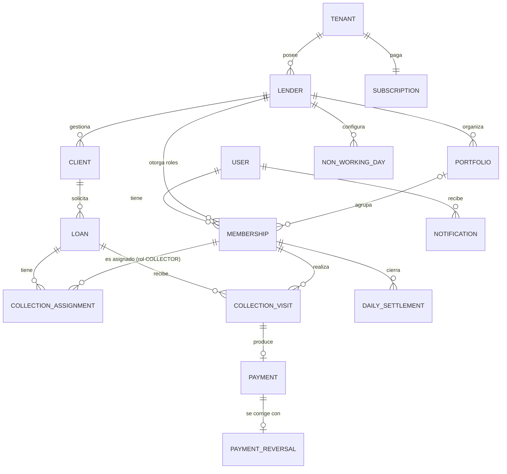

# Arquitectura — Sistema de Control de Cartera (Gota a Gota)

> Documento de producto: consolida las decisiones de dominio, arquitectura e infraestructura a nivel de negocio (entidades, multi-tenancy, suscripciones, roadmap). Esta es la copia canónica y versionada — actualízalo aquí cada vez que se tome una decisión nueva; es la fuente de verdad para cualquiera que se sume al proyecto (incluido tú mismo en 3 meses).
>
> Para la arquitectura de código de este repo (estructura de carpetas, convenciones, reglas de dependencia) ver [ARCHITECTURE.md](./ARCHITECTURE.md).

## 1. Resumen del proyecto

Sistema SaaS multi-tenant para que dueños de comercio (Owners) gestionen la operación de uno o varios prestamistas (Lenders) dedicados a crédito informal de cobro diario. El sistema **no calcula intereses ni procesa pagos reales** — es un libro de control (ledger) de acuerdos pactados manualmente entre el Lender y su cliente, con seguimiento de cobro en campo por parte de Collectors.

El valor diferencial del producto no es prestar dinero, es la **visibilidad**: mora en tiempo real, efectividad de cobro por cobrador, y estadísticas que hoy ninguna hoja de Excel puede dar de forma confiable.

## 2. Repositorios

| Repo | Contenido | Despliegue |
|---|---|---|
| `api` | NestJS, arquitectura hexagonal interna, Prisma | Fly.io (Docker) |
| `web` | Next.js + Tailwind, panel de Owner/Lender — **fase 2** (ver D-01) | Vercel |
| `mobile` | Expo (React Native), app única para Lender **y** Collector, navegación por rol | Distribución directa (sin Play Store) |
| `contracts` | Paquete npm privado `@fiaro-app/contracts` con schemas de Zod compartidos | GitHub Packages |

`contracts` no es una app, es una librería. Se versiona con semver (`1.2.0`) y `api`/`web` la instalan como dependencia normal. `mobile` puede consumirla también, pero no es obligatorio.

## 3. Stack tecnológico

| Capa | Tecnología | Justificación breve |
|---|---|---|
| Backend | NestJS + TypeScript | Arquitectura por capas, DI nativa, ecosistema maduro |
| ORM | **Prisma** | Migraciones declarativas, cliente tipado; se aísla del dominio con mapper (ver sección 4.3) |
| Base de datos relacional | PostgreSQL (Neon, free tier) | Fuente de verdad transaccional |
| Cache / colas | Redis (Upstash, free tier) + BullMQ | Cache de estado de crédito + jobs asíncronos de auditoría |
| Auditoría / logs de eventos | MongoDB Atlas M0 (free) | Datos no estructurados, nunca datos transaccionales del crédito |
| Frontend web | Next.js + Tailwind | Estándar actual, buen soporte de Vercel |
| App móvil | Expo (React Native, managed workflow) | Curva de entrada baja, OTA updates nativas |
| Autenticación | better-auth (librería self-hosted, tablas en nuestro Postgres vía Prisma), teléfono + contraseña | Sesiones, revocación y rate limit sin escribirlos; cero costo y cero lock-in. Sujeto a spike (ver D-08) |
| Almacenamiento de archivos | Cloudflare R2 (S3-compatible) con URLs firmadas | 10 GB gratis, sin costo de egress; logo ahora, KYC en fase 2 |
| CI/CD | GitHub Actions | Gratis, lint + test + build + deploy |
| Análisis estático | ESLint estricto + CodeQL | SonarCloud gratis solo en repos públicos — no aplica si el repo es privado |
| Logging | Pino (JSON estructurado) | Preparado para conectar a cualquier plataforma de observabilidad después |
| Errores | Sentry (free tier) | Visibilidad de errores en producción |

## 4. Arquitectura hexagonal (repo `api`)

### 4.1 Estructura por módulos

Un módulo por funcionalidad del dominio en `src/modules/<módulo>/` (`loans`, `clients`, `collections`...), cada uno con sus capas `domain`, `application` e `infrastructure`. El código transversal (auditoría, crypto, filtros, notificaciones, persistencia compartida, Swagger...) vive en `src/shared/`, con las mismas tres capas. El árbol completo, el propósito de cada carpeta y las convenciones de nombres están en [ARCHITECTURE.md §2](./ARCHITECTURE.md#2-estructura-de-carpetas).

### 4.2 Regla de dependencia (obligatoria)

Dentro de cada módulo, `domain` no importa de ninguna otra capa ni de librerías externas; `application` solo depende de `domain` (y de `@nestjs/common` para la inyección de dependencias); `infrastructure` puede depender de todo el módulo. Entre módulos, solo `application` usa el `application` de otro módulo; `shared` nunca depende de un módulo. Se fuerza con ESLint (`eslint-plugin-boundaries`), no con disciplina de equipo: el lint falla si una importación rompe la regla. Tabla completa en [ARCHITECTURE.md §3](./ARCHITECTURE.md#3-regla-de-dependencia-obligatoria-forzada-por-lint).

### 4.3 Prisma sin ensuciar el dominio

Prisma genera su propio cliente tipado, pero ese tipo **no es tu entidad de dominio**. Se traduce con un mapper explícito, siempre en `infrastructure`:

```typescript
// modules/loans/domain/entities/loan.entity.ts — sin decoradores, sin Prisma
export class Loan {
  private constructor(
    public readonly id: string,
    public readonly clientId: string,
    public readonly lenderId: string,
    public readonly principalAmount: number,
    public readonly totalPayable: number,
    public readonly status: LoanStatus,
  ) {}

  static reconstitute(props: LoanProps): Loan {
    return new Loan(props.id, props.clientId, props.lenderId, props.principalAmount, props.totalPayable, props.status);
  }
}
```

```typescript
// modules/loans/infrastructure/persistence/loan.mapper.ts
export class LoanMapper {
  static toDomain(record: PrismaLoan): Loan {
    return Loan.reconstitute({ ...record });
  }

  static toPersistence(loan: Loan): Prisma.LoanCreateInput {
    return { id: loan.id, clientId: loan.clientId, lenderId: loan.lenderId, /* ... */ };
  }
}
```

```typescript
// modules/loans/infrastructure/persistence/prisma-loan.repository.ts
@Injectable()
export class PrismaLoanRepository implements LoanRepository {
  constructor(private readonly prisma: PrismaService) {}

  async findById(id: string): Promise<Loan | null> {
    const record = await this.prisma.loan.findUnique({ where: { id } });
    return record ? LoanMapper.toDomain(record) : null;
  }
}
```

## 5. Modelo de dominio

> Diagrama conceptual (relaciones). La forma pública de cada entidad (campos, tipos y validaciones) está en el paquete `@fiaro-app/contracts`; el detalle de persistencia (columnas, índices, constraints) vive en `schema.prisma`. Este diagrama se regenera desde el esquema.



### Entidades clave

- **User**: identidad de login (una persona). Celular único global + contraseña; email opcional. Guarda también la cédula de la persona (obligatoria para cobradores) y `must_change_password`, porque son de la persona y de su credencial, no de su relación con un prestamista (D-34). **No tiene rol propio** — los roles viven en `Membership`. Tablas de sesión/cuenta las gestiona better-auth.
- **Membership**: `User` ↔ `Lender` con un **conjunto** de roles (`OWNER`, `LENDER`, `COLLECTOR`). Una misma cuenta puede tener los 3 a la vez (el operador que trabaja solo) — ver D-02. Campos propios: `portfolio_id` (obligatorio si tiene rol `COLLECTOR`), `status: ACTIVE | INACTIVE` y `deactivated_at`.
- **Tenant**: raíz de facturación. En el MVP el registro crea `Tenant` + `Lender` + `Membership` con los 3 roles en una sola transacción (1:1); el modelo ya soporta N Lenders por Tenant.
- **Lender**: la operación/negocio (`name`, `logo_url`, `non_working_weekdays`, `skip_national_holidays`). Aísla su cartera de otros Lenders, incluso del mismo Tenant.
- **Portfolio**: agrupación opcional de cobradores/clientes por zona. Cada Lender nace con una `General` por defecto.
- **NonWorkingDay** (+ días de la semana no hábiles en config del Lender): días en que no se cobra; excluidos del cálculo de fechas esperadas.
- **Client**: persona deudora, no es usuario. Aislado por `lender_id`; `national_id` **único por Lender**. Puede tener varios `Loan` activos a la vez (la UI alerta al crear uno nuevo).
- **Loan**: `principal_amount`, `installment_count`, `installment_value`, `total_payable`, `frequency` (`DAILY | WEEKLY | BIWEEKLY | MONTHLY`), `start_date`. `total_payable` es un **campo guardado** (la UI sugiere `cuotas × valor`, pero se respeta lo pactado). El calendario de cuotas **no se materializa**: fechas esperadas, mora y días de atraso se calculan desde `start_date + frequency − días no hábiles`. Saldo = `total_payable − Σ pagos netos`. Estados: `ACTIVE`, `PAID_OFF` (automático al llegar el saldo a cero) y `CANCELED` (anulación por error antes de recibir pagos) (D-35). Solo el Lender crea préstamos (el Collector no, en MVP).
- **CollectionAssignment**: quién cobra un préstamo y en qué ventana (`effective_to = NULL` → permanente; `effective_to = effective_from` → solo un día). Se asigna al **préstamo** (no al cliente) para conservar historial y medir efectividad por cobrador.
- **CollectionVisit**: bitácora de cada intento. `outcome`: `PAID | NOT_FOUND | REFUSED | RESCHEDULED`. Guarda un **snapshot** `expected_amount` (cuota vigente en ese momento); el monto cobrado y el medio de pago viven en su `Payment`, y "parcial"/"mayor" se derivan comparando ambos. `promised_date` opcional: si se llena, el préstamo reaparece en la ruta ese día. Si hay dinero, genera un `Payment` en la misma transacción. Su `id` (UUIDv7) lo genera el dispositivo para soportar registro offline y funciona como llave de idempotencia (D-29).
- **Payment**: **append-only**. `method: CASH | NEQUI | TRANSFER` (default `CASH`). Un pago por visita (`visit_id` único): como el `id` de la visita lo genera el dispositivo, reenviarla nunca duplica el pago.
- **PaymentReversal**: única forma de corregir un pago. Anula el pago completo y un pago se reversa una sola vez; si el monto correcto era otro, se registra un pago nuevo. Solo la crea un rol `LENDER`, con `reason` obligatorio.
- **DailySettlement**: cierre diario del cobrador (esperado vs. cobrado, con desglose por medio de pago). Uno por cobrador y día; reenviarlo lo actualiza y lo devuelve a `PENDING`. Los montos son los declarados al cerrar (D-36). Nota **obligatoria si hay diferencia**. `APPROVED`/`REJECTED` por el Lender, con nota de revisión; el rechazo es informativo (no bloquea la ruta), el cobrador puede reenviar con aclaración.
- **Notification**: destinatario es `user_id` (sirve para ambos roles), con `severity` (`ALERT | WARNING | SUCCESS | INFO`) y un enlace opcional a la entidad relacionada. MVP: Lender recibe alertas de cuadres/mora; Collector recibe "cuadre rechazado" y "préstamo asignado".
- **Subscription**: plan del Tenant, determina límite de Lenders activos. Guarda el fin del período pagado; el estado (`ACTIVE`, `GRACE_PERIOD`, `READ_ONLY`) se calcula a partir de las fechas.

> Nota de tipos: los montos en pesos colombianos se modelan como enteros, no como `DECIMAL(12,2)` — el COP no maneja centavos en la práctica de este negocio. Cada registro usa `INTEGER` (hasta unos 2.147 millones de pesos por préstamo o pago); las sumas agregadas se calculan como enteros de 64 bits. Ajustar solo si en algún momento se soporta otra moneda.

## 6. Multi-tenancy y control de acceso

- **Aislamiento por fila**, no por schema — cada tabla relevante tiene `lender_id`, indexado.
- **Row Level Security (RLS) de Postgres como segunda capa**, además del guard de aplicación — nunca confiar solo en que el código de la app filtre bien.
- **`LenderScopeGuard`**: toma `lenderId` de la sesión (membership activa), nunca del body/query del request. Si la request se hace en **modo cobrador**, valida además que el préstamo tenga una `CollectionAssignment` vigente para esa membership.
- **Roles acumulables**: la autorización se evalúa contra el *conjunto* de roles de la membership, no contra un único rol. La app móvil muestra un selector "Modo Admin / Modo Cobrador" solo si la cuenta tiene ambos.
- **Desactivar un cobrador** exige reasignar sus préstamos en el mismo flujo (una transacción: cierra asignaciones viejas con `effective_to`, abre nuevas). Nunca quedan préstamos sin cobrador.
- La matriz completa rol × recurso × acción vive en `PERMISSIONS.md` (pendiente, siguiente paso).

## 7. Suscripciones y facturación

- Enforcement: **modo solo lectura** cuando la suscripción no está activa. Todo `GET` sigue funcionando; `POST/PUT/PATCH/DELETE` se bloquean salvo el propio endpoint de renovación.
- **Período de gracia: 7 días** tras el vencimiento, con banner diario de "renueva". Después, solo lectura — **excepto registrar visitas/pagos**, que siempre se permiten (bloquear el cobro perjudica al deudor y al Lender, y genera rechazo al producto).
- Plan recomendado: por número de Lenders activos, no por cartera gestionada (cartera gestionada es una métrica que el propio sistema reporta, circular como base de facturación).

## 8. Autenticación

- **Login con celular colombiano (10 dígitos, guardado en formato E.164 `+573001234567`, único global) + contraseña** (D-27); email opcional (recuperación, reportes). Muchos cobradores no usan correo.
- **Librería: better-auth** corriendo dentro del API, con adaptador Prisma — las tablas de usuario/sesión quedan en nuestro Postgres. better-auth resuelve **autenticación** (sesiones, revocación, rate limit); la **autorización** (roles, `lender_id`, asignaciones, RLS) es código propio del dominio. Antes de adoptarla: spike de ½ día validando NestJS + plugin de Expo + login por teléfono. Plan B: JWT + refresh propio con Passport.
- **Sesión móvil larga (~30 días), revocable desde el servidor**, guardada cifrada en el dispositivo (SecureStore).
- **PIN / huella = desbloqueo local** de esa sesión (`expo-local-authentication`). No existe `/auth/login-pin`; funciona offline.
- El Collector no se autoregistra: el Lender lo crea, el backend genera contraseña temporal que se muestra **una sola vez** (para enviarla por WhatsApp) y `must_change_password` obliga a cambiarla en el primer login. Si el teléfono ya tiene cuenta, se le agrega la membership en vez de crear otro usuario.

## 9. Infraestructura y despliegue

| Servicio | Proveedor | Costo | Nota |
|---|---|---|---|
| API | Fly.io | ~5-7 USD/mes | Único componente que paga, para evitar cold start en campo |
| Web | Vercel | Gratis | |
| PostgreSQL | Neon | Gratis | Autosuspend con latencia baja, aceptable |
| Redis | Upstash | Gratis | También usado como broker de BullMQ |
| MongoDB (auditoría) | Atlas M0 | Gratis | Solo eventos, nunca datos transaccionales |
| Paquete `contracts` | GitHub Packages | Gratis (repo privado) | Requiere configurar auth en CI de `api` y `web` |
| CI/CD | GitHub Actions | Gratis | |

### Flujo de auditoría (Mongo desacoplado, sin dual-write)

```typescript
// Después de confirmar el pago en Postgres (no antes)
await this.auditQueue.add(
  'payment.registered',
  { loanId, amount, registeredBy, occurredAt: new Date() },
  { attempts: 3, backoff: { type: 'exponential', delay: 2000 } },
);
```

Si el job de auditoría falla tras reintentos, se pierde una entrada de log — nunca un pago real, porque Postgres ya lo confirmó antes de encolar el evento.

## 10. Estrategia móvil (Lender + Collector, sin Play Store)

- **Android-only en el MVP, distribución directa del APK** (confirmado). iOS se evalúa cuando un cliente lo pida (requiere Apple Developer, 99 USD/año).
- **Offline para registrar visitas**: la ruta del día se descarga al abrir la app; visitas y pagos se encolan localmente y se sincronizan al recuperar señal. Requisitos que se fijan desde el esquema: el `id` de cada visita es un UUIDv7 generado en el dispositivo y sirve de llave de idempotencia (D-29); `occurred_at` (hora real del cobro) es distinto de `created_at` (hora de llegada al servidor). El resto de la app (altas, estadísticas, admin) es online.
- **EAS Update (OTA)** cubre el 99% de las actualizaciones (lógica, UI, textos) sin que el cobrador haga nada.
- **Firebase App Distribution** para los pocos cambios que requieren nueva build nativa (cambio de SDK de Expo, nuevo permiso).
- **Version-gate obligatorio**: la app consulta `GET /mobile/version` antes de mostrar cualquier pantalla; si está por debajo de `minimumSupportedVersion`, bloquea con pantalla de actualización y el link de descarga.
- Cuidado con `runtimeVersion`: cambia al subir el SDK de Expo o agregar módulos nativos, y en ese momento las OTA dejan de aplicar a builds viejas — ahí es cuando se necesita el flujo de Firebase App Distribution.

## 11. Migración de datos

**Arranque limpio confirmado**: los Lenders que se unan a la plataforma no migran su cartera activa del Excel. Los créditos viejos se terminan de cobrar en la hoja actual; todo crédito nuevo se registra directo en el sistema. No se requiere importador.

## 12. Roadmap propuesto

**Fase 1 (MVP — núcleo del control de cartera):**
- CRUD de Lender, Client, Loan
- Registro de visitas de cobro (`CollectionVisit`) + ledger de pagos
- Dashboard de mora, saldo y efectividad de cobro por cobrador
- Multi-tenancy + RBAC de 3 niveles
- Suscripción con límite de Lenders + modo solo lectura al vencer

**Fase 2 (extras, sin prioridad definida aún):**
- Recordatorios automáticos por WhatsApp (Twilio) antes del vencimiento de cuota
- Captura de foto + cédula del cliente al crear el crédito (KYC básico, para disputas)
- Ruta de cobro geolocalizada para el Collector
- Alerta informativa si la tasa efectiva implícita (`total_a_pagar / valor_prestado`) supera la tasa de usura vigente (Superintendencia Financiera)

## 13. Próximas definiciones

Temas abiertos para iteraciones posteriores al MVP, ninguno bloquea el diseño del esquema:

- Precio y límites de cada plan de suscripción (número de Lenders por plan).
- Priorización de extras de Fase 2 (WhatsApp, KYC, ruta geolocalizada, comparativo contra período anterior).
- Spike técnico de better-auth (NestJS + Expo + login por teléfono), previo a implementar el módulo `auth`.

## 14. Registro de decisiones

Decisiones D-01 a D-26 tomadas el 2026-09-22, al cerrar el diseño; D-27 en adelante, el 2026-09-23, al definir los contratos y configurar la API. Cada una tiene un ID para poder referenciarla desde código, PRs y otros documentos. Si una se revierte, se tacha y se agrega la nueva — no se borra.

| ID | Tema | Decisión | Por qué |
|---|---|---|---|
| D-01 | App del Lender | Móvil en MVP (una sola app Expo con navegación por rol); web en fase 2 | El Lender de gota a gota opera desde el celular; evita construir dos frontends a la vez |
| D-02 | Roles | `User` + `Membership` con **conjunto** de roles; una cuenta puede ser Owner + Lender + Collector | Operadores que trabajan solos; el mismo producto escala a negocios con equipo |
| D-03 | Tenant vs Lender | Se mantienen separados; registro crea ambos 1:1; sin panel de Owner en MVP | Suscripción por nº de Lenders sin migración futura |
| D-04 | Plataforma | Android-only, APK directo | Costo $0, es lo que usan los cobradores |
| D-05 | Offline | Offline solo para registrar visitas/pagos; UUID en cliente + ~~`idempotency_key`~~ (reemplazado por D-29) | La señal en campo es irregular; sin esto el cobrador vuelve al papel |
| D-06 | Multi-rol en UI | Selector "Modo Admin / Modo Cobrador", visible solo con ambos roles | Reutiliza las pantallas del prototipo sin rediseño |
| D-07 | Identificador de login | Teléfono + contraseña; email opcional | Muchos cobradores no usan correo |
| D-08 | Librería de auth | better-auth (self-hosted), sujeto a spike | Control total de datos, $0, ahorra sesiones/revocación/rate limit |
| D-09 | PIN | Desbloqueo local + huella de una sesión larga revocable | Funciona offline, sin endpoint extra |
| D-10 | Calendario | `frequency` por préstamo + días no hábiles por Lender; cuotas calculadas, no materializadas | Soporta diario/semanal/etc. sin miles de filas |
| D-11 | `total_payable` | Campo guardado, sugerido = cuotas × valor | Respeta acuerdos no lineales y redondeos |
| D-12 | Cartera | Entidad `Portfolio` opcional, `General` por defecto | Filtros consistentes en estadísticas sin forzar al operador solo |
| D-13 | Asignación | Por préstamo, con historial (`effective_from/to`) | Reemplazos de un día + efectividad por cobrador exacta |
| D-14 | Outcome | `PAID` + snapshot `expected_amount`; parcial/mayor derivados | Sin duplicar información; reportes históricos estables |
| D-15 | Método de pago | `CASH | NEQUI | TRANSFER`, default `CASH` | El cuadre necesita saber cuánto efectivo entrega el cobrador |
| D-16 | Corrección de pagos | Solo Lender, vía `PaymentReversal` con motivo | Auditoría completa; evita que un cobrador borre dinero cobrado |
| D-17 | Promesa de pago | `promised_date` opcional; el préstamo reaparece en la ruta ese día | Seguimiento de promesas incumplidas |
| D-18 | Desactivar cobrador | Reasignación obligatoria en el mismo flujo, transaccional | Nunca préstamos huérfanos |
| D-19 | Cuadre | Rechazo informativo (no bloquea ruta); nota obligatoria si hay diferencia | La cobranza no puede parar; trazabilidad de faltantes |
| D-20 | Notificaciones | Destinatario `user_id`; Collector recibe lo esencial | Un solo modelo para ambos roles |
| D-21 | Gracia de suscripción | 7 días; luego solo lectura excepto registrar pagos | No castigar al deudor ni generar rechazo |
| D-22 | Préstamos simultáneos | Permitidos, con alerta al crear | Práctica común de "renovar" antes de terminar |
| D-23 | Alta desde campo | Solo el Lender crea clientes/préstamos en MVP | El Lender presta el dinero; el operador solo tiene ambos roles igual |
| D-24 | Alcance de clientes | Por Lender, cédula única por Lender | Aislamiento ya definido en §6 |
| D-25 | Storage | Cloudflare R2 con URLs firmadas | 10 GB gratis, sin egress |
| D-26 | Lecturas con filtros | Método HTTP `QUERY` con body JSON para búsquedas, filtros y reportes; `GET` solo para lecturas por identificador | Filtros tipados y validados con Zod, sin límites de URL ni datos sensibles en logs de acceso (ver ARCHITECTURE.md §5) |
| D-27 | Formato de teléfono | Celulares y fijos colombianos de 10 dígitos, guardados y transmitidos en E.164 (`+573001234567`). Corrige la regla anterior de 11 dígitos | Es el formato real en Colombia y el que exigen WhatsApp/Twilio para los recordatorios de fase 2 |
| D-28 | Documento de identidad | Solo cédula de ciudadanía, en dígitos sin puntos | Alcance definido para el MVP |
| D-29 | Idempotencia offline | El `id` de la visita (UUIDv7 generado en el dispositivo) es la llave de idempotencia; no existe un campo `idempotency_key` aparte | Reenviar una visita devuelve el resultado original sin duplicar el pago, con un campo menos |
| D-30 | Contratos compartidos | `@fiaro-app/contracts` define entidades, requests, respuestas y endpoints (`defineEndpoint`); la API valida con esos schemas de Zod | Una sola fuente de verdad para api, mobile y web; reemplaza los DTOs con class-validator |
| D-31 | Formato de datos en la API | JSON en camelCase; fechas de calendario `AAAA-MM-DD` y marcas de tiempo ISO 8601 con zona horaria; dinero en enteros; `null` explícito en las respuestas | Detalle y razones en el README de `contracts` |
| D-32 | Identificadores | UUIDv7 para todas las entidades | Se ordenan por fecha (índices compactos) y se pueden generar sin conexión |
| D-33 | Empaquetado de contracts | Solo ESM, compilado con tsdown; TypeScript 6.0 (el más nuevo que soportan typescript-eslint y TypeDoc); Node 24 | Herramientas actuales y mantenidas; se sube a TypeScript 7 cuando esas herramientas lo soporten |
| D-34 | Datos de la persona | La cédula y `must_change_password` viven en `User`, no en `Membership` | Son de la persona y de su credencial: quien trabaja para dos prestamistas tiene una sola cédula y una sola contraseña |
| D-35 | Estados y calendario del préstamo | `ACTIVE`, `PAID_OFF` (automático con saldo cero) y `CANCELED` (anulación por error antes de pagos). Quincenal = cada 15 días; mensual = mismo día de cada mes (o el último si el mes es más corto); una fecha que cae en día sin cobro pasa al siguiente día de cobro | Reglas necesarias para calcular ruta, mora y días de atraso sin ambigüedad |
| D-36 | Unicidad del cuadre | Un cuadre por cobrador y día; reenviarlo lo actualiza y vuelve a `PENDING`; guarda los montos declarados al cerrar | Evita cuadres duplicados; el historial de cambios queda en la auditoría |
| D-37 | Estructura de la API | Un módulo por funcionalidad en `src/modules/<módulo>/` con sus capas `domain`, `application` e `infrastructure`; lo transversal en `src/shared/` con las mismas capas; nombres de carpeta en plural. Entre módulos solo se usan los casos de uso (`application`) | Todo lo de una funcionalidad queda junto y cada módulo puede cambiar su modelo interno sin romper a los demás; ESLint fuerza las reglas |
| D-38 | Herramientas de calidad de la API | ESLint (typescript-eslint con tipos + eslint-plugin-boundaries) en lugar de oxlint; Prettier; Husky + lint-staged + commitlint; pruebas compiladas con SWC y cobertura mínima de 80 % | boundaries es la única forma de forzar la regla de capas; los hooks detectan errores antes del CI y solo revisan lo que cambió |
| D-39 | Método de merge | PR de funcionalidad → `dev`: squash. PR de release `dev` → `main`: merge commit. Configurado en los cuatro repos (el plan Free no permite forzarlo por rama, así que es convención) | Con squash en los releases, `main` acumula commits que `dev` no tiene y cada release siguiente genera conflictos |
