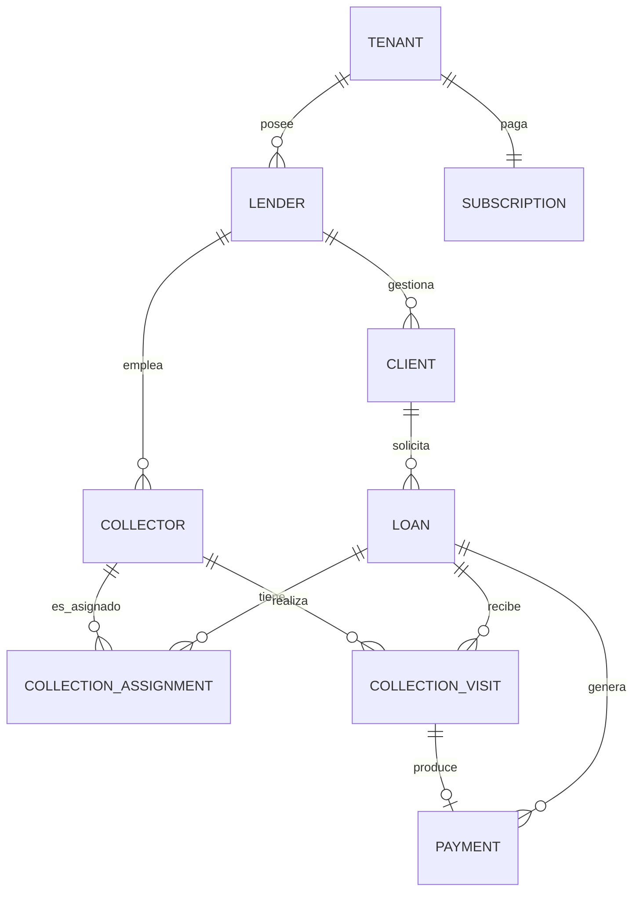

# Arquitectura — Sistema de Control de Cartera (Gota a Gota)

> Documento de producto: consolida las decisiones de dominio, arquitectura e infraestructura a nivel de negocio (entidades, multi-tenancy, suscripciones, roadmap). Esta es la copia canónica y versionada — actualízalo aquí cada vez que se tome una decisión nueva; es la fuente de verdad para cualquiera que se sume al proyecto (incluido tú mismo en 3 meses).
>
> Para la arquitectura de código de este repo (estructura de carpetas, convenciones, reglas de dependencia) ver [ARCHITECTURE.md](./ARCHITECTURE.md).

## 1. Resumen del proyecto

Sistema SaaS multi-tenant para que dueños de comercio (Owners) gestionen la operación de uno o varios prestamistas (Lenders) dedicados a crédito informal de cobro diario. El sistema **no calcula intereses ni procesa pagos reales** — es un libro de control (ledger) de acuerdos pactados manualmente entre el Lender y su cliente, con seguimiento de cobro en campo por parte de Collectors.

El valor diferencial del producto no es prestar dinero, es la **visibilidad**: mora en tiempo real, efectividad de cobro por cobrador, y estadísticas que hoy ninguna hoja de Excel puede dar de forma confiable.

## 2. Repositorios

| Repo | Contenido | Despliegue |
|---|---|---|
| `api` | NestJS, arquitectura hexagonal interna, Prisma | Fly.io (Docker) |
| `web` | Next.js + Tailwind, panel de Owner/Lender | Vercel |
| `mobile` | Expo (React Native), app del Collector | Distribución directa (sin Play Store) |
| `contracts` | Paquete npm privado `@tuorg/contracts` con schemas de Zod compartidos | GitHub Packages |

`contracts` no es una app, es una librería. Se versiona con semver (`1.2.0`) y `api`/`web` la instalan como dependencia normal. `mobile` puede consumirla también, pero no es obligatorio.

## 3. Stack tecnológico

| Capa | Tecnología | Justificación breve |
|---|---|---|
| Backend | NestJS + TypeScript | Arquitectura por capas, DI nativa, ecosistema maduro |
| ORM | **Prisma** | Migraciones declarativas, cliente tipado; se aísla del dominio con mapper (ver sección 4.3) |
| Base de datos relacional | PostgreSQL (Neon, free tier) | Fuente de verdad transaccional |
| Cache / colas | Redis (Upstash, free tier) + BullMQ | Cache de estado de crédito + jobs asíncronos de auditoría |
| Auditoría / logs de eventos | MongoDB Atlas M0 (free) | Datos no estructurados, nunca datos transaccionales del crédito |
| Frontend web | Next.js + Tailwind | Estándar actual, buen soporte de Vercel |
| App móvil | Expo (React Native, managed workflow) | Curva de entrada baja, OTA updates nativas |
| Autenticación | JWT + refresh token, email + contraseña para todos los roles | Simplicidad; Collector se crea por invitación del Lender |
| CI/CD | GitHub Actions | Gratis, lint + test + build + deploy |
| Análisis estático | ESLint estricto + CodeQL | SonarCloud gratis solo en repos públicos — no aplica si el repo es privado |
| Logging | Pino (JSON estructurado) | Preparado para conectar a cualquier plataforma de observabilidad después |
| Errores | Sentry (free tier) | Visibilidad de errores en producción |

## 4. Arquitectura hexagonal (repo `api`)

### 4.1 Estructura de carpetas por módulo de dominio

```
src/
  modules/
    loans/
      domain/           # Entidades y lógica de negocio pura — CERO dependencias de Prisma/Nest
      application/       # Casos de uso (use cases), puertos (interfaces de repositorio)
      infrastructure/     # Adaptadores: PrismaLoanRepository, mappers, controllers
    collections/
      domain/ | application/ | infrastructure/
    subscriptions/
      domain/ | application/ | infrastructure/
    auth/
      ...
  shared/
    prisma/             # PrismaService, schema.prisma
    guards/             # LenderScopeGuard, SubscriptionGuard, etc.
```

### 4.2 Regla de dependencia (obligatoria)

`domain` nunca importa de `infrastructure`. `application` puede depender de `domain`, nunca al revés. Esto se fuerza con lint, no con disciplina de equipo:

```json
// .eslintrc.json
{
  "plugins": ["boundaries"],
  "settings": {
    "boundaries/elements": [
      { "type": "domain", "pattern": "src/modules/*/domain/**" },
      { "type": "application", "pattern": "src/modules/*/application/**" },
      { "type": "infrastructure", "pattern": "src/modules/*/infrastructure/**" }
    ]
  },
  "rules": {
    "boundaries/element-types": ["error", {
      "rules": [
        { "from": "domain", "allow": ["domain"] },
        { "from": "application", "allow": ["domain", "application"] },
        { "from": "infrastructure", "allow": ["domain", "application", "infrastructure"] }
      ]
    }]
  }
}
```

### 4.3 Prisma sin ensuciar el dominio

Prisma genera su propio cliente tipado, pero ese tipo **no es tu entidad de dominio**. Se traduce con un mapper explícito, siempre en `infrastructure`:

```typescript
// modules/loans/domain/loan.entity.ts — sin decoradores, sin Prisma
export class Loan {
  private constructor(
    public readonly id: string,
    public readonly clientId: string,
    public readonly lenderId: string,
    public readonly principalAmount: number,
    public readonly totalPayable: number,
    public readonly status: LoanStatus,
  ) {}

  static reconstitute(props: LoanProps): Loan {
    return new Loan(props.id, props.clientId, props.lenderId, props.principalAmount, props.totalPayable, props.status);
  }
}
```

```typescript
// modules/loans/infrastructure/loan.mapper.ts
export class LoanMapper {
  static toDomain(record: PrismaLoan): Loan {
    return Loan.reconstitute({ ...record });
  }

  static toPersistence(loan: Loan): Prisma.LoanCreateInput {
    return { id: loan.id, clientId: loan.clientId, lenderId: loan.lenderId, /* ... */ };
  }
}
```

```typescript
// modules/loans/infrastructure/prisma-loan.repository.ts
@Injectable()
export class PrismaLoanRepository implements LoanRepository {
  constructor(private readonly prisma: PrismaService) {}

  async findById(id: string): Promise<Loan | null> {
    const record = await this.prisma.loan.findUnique({ where: { id } });
    return record ? LoanMapper.toDomain(record) : null;
  }
}
```

## 5. Modelo de dominio



### Entidades clave

- **Tenant**: el Owner. Raíz de facturación y de aislamiento multi-tenant.
- **Lender**: opera su propia cartera, aislada de otros Lenders (incluso del mismo Tenant).
- **Collector**: empleado de un Lender, ve solo los clientes que tiene asignados. Se autentica con email + contraseña, creado por invitación del Lender.
- **Client**: persona deudora. No es un usuario del sistema. Aislado por `lender_id`.
- **Loan**: `principal_amount`, `installment_count`, `installment_value`, `total_payable` — **todos ingresados manualmente por el Lender**, el sistema no calcula interés.
- **CollectionAssignment**: quién cobra un crédito y en qué ventana de fechas (`effective_to = NULL` → permanente; `effective_to = effective_from` → solo un día).
- **CollectionVisit**: bitácora de cada intento de cobro (`PAID`, `PARTIAL`, `NOT_FOUND`, `REFUSED`, `RESCHEDULED`). Si implica dinero, genera un `Payment` en la misma transacción.
- **Payment**: **append-only**, nunca se edita ni se borra. Correcciones se hacen con `PaymentReversal`, nunca con `UPDATE`.
- **Subscription**: plan del Tenant, determina límite de Lenders activos.

> Nota de tipos: los montos en pesos colombianos se modelan como enteros (`INTEGER` / `NUMERIC(12,0)`), no como `DECIMAL(12,2)` — el COP no maneja centavos en la práctica de este negocio. Ajustar solo si en algún momento se soporta otra moneda.

## 6. Multi-tenancy y control de acceso

- **Aislamiento por fila**, no por schema — cada tabla relevante tiene `lender_id`, indexado.
- **Row Level Security (RLS) de Postgres como segunda capa**, además del guard de aplicación — nunca confiar solo en que el código de la app filtre bien.
- **`LenderScopeGuard`**: extrae `lenderId` del JWT, nunca del body/query del request. Si el usuario es `COLLECTOR`, valida además que el recurso esté dentro de sus `assignedClientIds`.

## 7. Suscripciones y facturación

- Enforcement: **modo solo lectura** cuando la suscripción no está activa. Todo `GET` sigue funcionando; `POST/PUT/PATCH/DELETE` se bloquean salvo el propio endpoint de renovación.
- **Pendiente de definir**: período de gracia antes de pasar a solo lectura (¿inmediato al vencer, o unos días de margen?).
- Plan recomendado: por número de Lenders activos, no por cartera gestionada (cartera gestionada es una métrica que el propio sistema reporta, circular como base de facturación).

## 8. Autenticación

- **Todos los roles (Owner, Lender, Collector) usan email + contraseña**, JWT + refresh token.
- El Collector no se autoregistra: el Lender lo invita (endpoint de invitación → email con link para fijar contraseña).
- Pendiente de diseñar en detalle: expiración de refresh token, revocación de sesión, rate limiting de login (`@nestjs/throttler`).

## 9. Infraestructura y despliegue

| Servicio | Proveedor | Costo | Nota |
|---|---|---|---|
| API | Fly.io | ~5-7 USD/mes | Único componente que paga, para evitar cold start en campo |
| Web | Vercel | Gratis | |
| PostgreSQL | Neon | Gratis | Autosuspend con latencia baja, aceptable |
| Redis | Upstash | Gratis | También usado como broker de BullMQ |
| MongoDB (auditoría) | Atlas M0 | Gratis | Solo eventos, nunca datos transaccionales |
| Paquete `contracts` | GitHub Packages | Gratis (repo privado) | Requiere configurar auth en CI de `api` y `web` |
| CI/CD | GitHub Actions | Gratis | |

### Flujo de auditoría (Mongo desacoplado, sin dual-write)

```typescript
// Después de confirmar el pago en Postgres (no antes)
await this.auditQueue.add(
  'payment.registered',
  { loanId, amount, registeredBy, occurredAt: new Date() },
  { attempts: 3, backoff: { type: 'exponential', delay: 2000 } },
);
```

Si el job de auditoría falla tras reintentos, se pierde una entrada de log — nunca un pago real, porque Postgres ya lo confirmó antes de encolar el evento.

## 10. Estrategia móvil (Collector, sin Play Store)

- **Distribución directa del APK** — Android asumido por ahora (**pendiente de confirmar si se necesita iOS**; iOS sin App Store requiere cuenta Apple Developer, 99 USD/año, sin alternativa gratuita).
- **EAS Update (OTA)** cubre el 99% de las actualizaciones (lógica, UI, textos) sin que el cobrador haga nada.
- **Firebase App Distribution** para los pocos cambios que requieren nueva build nativa (cambio de SDK de Expo, nuevo permiso).
- **Version-gate obligatorio**: la app consulta `GET /mobile/version` antes de mostrar cualquier pantalla; si está por debajo de `minimumSupportedVersion`, bloquea con pantalla de actualización y el link de descarga.
- Cuidado con `runtimeVersion`: cambia al subir el SDK de Expo o agregar módulos nativos, y en ese momento las OTA dejan de aplicar a builds viejas — ahí es cuando se necesita el flujo de Firebase App Distribution.

## 11. Migración de datos

**Arranque limpio confirmado**: los Lenders que se unan a la plataforma no migran su cartera activa del Excel. Los créditos viejos se terminan de cobrar en la hoja actual; todo crédito nuevo se registra directo en el sistema. No se requiere importador.

## 12. Roadmap propuesto

**Fase 1 (MVP — núcleo del control de cartera):**
- CRUD de Lender, Client, Loan
- Registro de visitas de cobro (`CollectionVisit`) + ledger de pagos
- Dashboard de mora, saldo y efectividad de cobro por cobrador
- Multi-tenancy + RBAC de 3 niveles
- Suscripción con límite de Lenders + modo solo lectura al vencer

**Fase 2 (extras, sin prioridad definida aún):**
- Recordatorios automáticos por WhatsApp (Twilio) antes del vencimiento de cuota
- Captura de foto + cédula del cliente al crear el crédito (KYC básico, para disputas)
- Ruta de cobro geolocalizada para el Collector
- Alerta informativa si la tasa efectiva implícita (`total_a_pagar / valor_prestado`) supera la tasa de usura vigente (Superintendencia Financiera)

## 13. Decisiones pendientes / supuestos a confirmar

- [ ] ¿Alcance móvil es Android-only, o se necesita iOS en algún momento?
- [ ] Período de gracia antes de activar modo solo lectura por suscripción vencida
- [ ] Enum final de `outcome` en `CollectionVisit` (¿hacen falta estados como "prometió pagar mañana" o "cliente viajó"?)
- [ ] Expiración y política de revocación de refresh tokens
- [ ] Definición final del pricing por tier (número de Lenders por plan, precio)
- [ ] Priorización de extras de Fase 2 (WhatsApp, KYC, ruta geolocalizada)
